<div align="center">


# leaf & bowl with BE

**오늘의 신선한 한 그릇**

샐러드를 고르고, 취향을 발견하고, 나만의 한 끼를 완성하는 쇼핑몰 체험 프로젝트.


[프로젝트 소개](#프로젝트-소개) · [2차 프로젝트](#2차-프로젝트--회원주문-fastapi-고도화) · [주요 기능](#주요-기능) · [화면 미리보기](#화면-미리보기) · [1차 과제 요구사항](#1차-과제-요구사항-대응) · [시작하기](#시작하기) · [개발 가이드](#개발-가이드) · [관련 문서](#관련-문서)

</div>

---

## 프로젝트 소개

**leaf & bowl**은 샐러드와 음료 탐색부터 옵션 선택, 장바구니, 예약 배달과 결제 화면까지 이어지는 웹 프로젝트입니다. 재료를 골라 취향에 맞는 조합을 만드는 **bowl match**와 메뉴·옵션·리뷰·사이트 문구를 관리하는 **관리자 화면**을 함께 제공합니다.

Next.js App Router 기반으로 고객 화면과 관리자 화면을 구성하고, 공통 카탈로그를 통해 저장한 변경 사항을 고객 화면에 반영합니다.

> **체험 범위** · 고객 회원가입·로그인은 FastAPI(OAuth2·JWT)로 동작하고, 회원 주문은 결제 없이 바로 접수됩니다. 비회원 주문의 결제는 토스페이먼츠 **테스트 결제**라 실제 청구가 없습니다. 주문·회원·관리자 데이터는 PostgreSQL에 저장되고, 초기 리뷰는 예시 데이터입니다.

## 2차 프로젝트 — 회원·주문 FastAPI 고도화

5조가 만든 **leaf & bowl**(Next.js·Prisma·PostgreSQL)을 팀 **나경님언제5조**가 인수해, 비어 있던 고객 회원·개인 데이터·회원 주문·관리자 인증을 FastAPI 도메인 중심 4계층 백엔드로 연결·확장했습니다.

### 인수 정보

| 항목 | 내용 |
| --- | --- |
| 인수 기준 | `main` 커밋 [`04d9936`](https://github.com/KANT-2/leaf-bowl/commit/04d9936) (2026-10-23, FastAPI 추가 직전) |
| 인수 당시 상태 | 화면·API·업무 규칙·DB 접근이 Next.js 한 앱에 있음. 고객 로그인은 localStorage 모의 방식, 주문은 익명 세션 기준, 관리자만 DB 세션 인증 |
| 이번 팀의 추가 | `backend/` FastAPI(Python 3.13·uv), 회원 테이블과 회원 주문 연결(Prisma 마이그레이션 `0011_member_orders`), 화면 연동 |
| 기간 | 2026-10-23 ~ 2026-10-28 |

### 무엇이 달라졌나

| 구분 | 인수 당시 | 현재 |
| --- | --- | --- |
| 고객 로그인 | 브라우저 localStorage 모의 로그인 | OAuth2 password flow · JWT 발급 · 로그아웃 토큰 블랙리스트(재사용 시 401) |
| 고객 주문 | 익명 세션 기준. 브라우저가 바뀌면 조회 불가 | 회원(`customer_id`) 기준. 어디서든 목록·상태·기간 필터·취소·영수증 |
| 개인 데이터 | 프로필·배송지·나만의 볼이 브라우저에만 | 내 정보·배송지·나만의 볼·로그인 이력을 서버(DB)에 저장 |
| 백엔드 구조 | TypeScript 폴더 관례로 계층 구분 | FastAPI 도메인 중심 4계층(표현·응용·도메인·인프라), 순수 파이썬 도메인 |
| DB 접근 | Prisma | 비동기 SQLAlchemy(`AsyncSession`·asyncpg) Repository |

| 인수 당시 | 현재 |
| --- | --- |
| 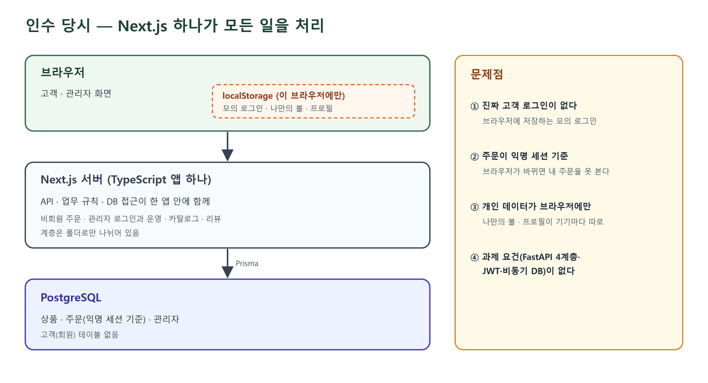 | 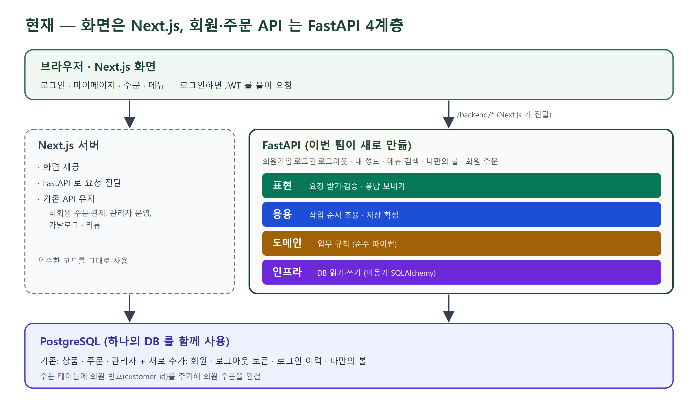 |

### Next.js 와 FastAPI 의 담당 범위

두 서버가 **같은 PostgreSQL** 을 씁니다. 화면은 `/backend/*` 로 요청하고 Next.js 가 FastAPI 로 전달합니다(`next.config.ts` rewrites, `BACKEND_URL`).

| 서버 | 담당 |
| --- | --- |
| **FastAPI** (`backend/`, 이번 팀) | 회원가입·로그인·로그아웃, 내 정보·배송지·로그인 이력, 메뉴 검색, 나만의 볼, 회원 주문(생성·목록·상세·취소·영수증), 관리자 JWT 로그인·로그아웃 |
| **Next.js** (인수 코드 유지) | 화면 제공과 FastAPI 전달, 비회원 주문·테스트 결제·세션, 관리자 운영(배달 주문·메뉴·이벤트·매출·이미지), 공개 카탈로그·리뷰 |

테이블 구조(스키마)는 Prisma 마이그레이션이 관리하고, FastAPI 는 인수한 테이블을 매핑해 직접 읽고 씁니다. 회원·토큰 블랙리스트·로그인 이력·나만의 볼처럼 FastAPI 가 새로 만든 테이블은 `lifespan` 에서 준비합니다.

### 4계층 구조와 요청 흐름

```
backend/src/<기능>/
├── presentation/    요청·응답 검증(Pydantic), 라우터 — FastAPI 는 여기서만
├── application/     조회 → 도메인 행위 → 저장 → commit 조율
├── domain/          업무 규칙 · 상태 전이 (순수 파이썬)
└── infrastructure/  ORM 모델 · 비동기 SQL · ORM ↔ 도메인 변환
```

의존 방향은 `presentation → application → domain ← infrastructure` 입니다. 기능: `auth`, `customers`, `catalog`, `bowls`, `orders`, `admin_orders`. 공통 설정·보안·예외는 `core/`, 앱 조립은 `main.py`, DB 엔진·세션은 `database.py` 에 있습니다. 자세한 규칙은 [backend/README](backend/README.md#구조).

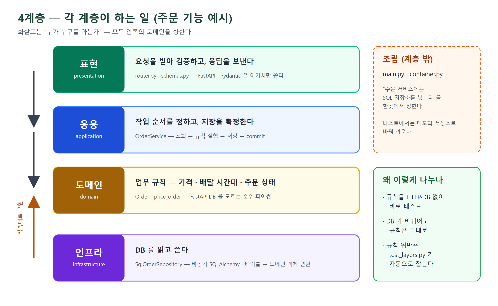

| 로그인 (`POST /api/auth/token`) | 회원 주문 생성 (`POST /api/v1/orders`) |
| --- | --- |
| 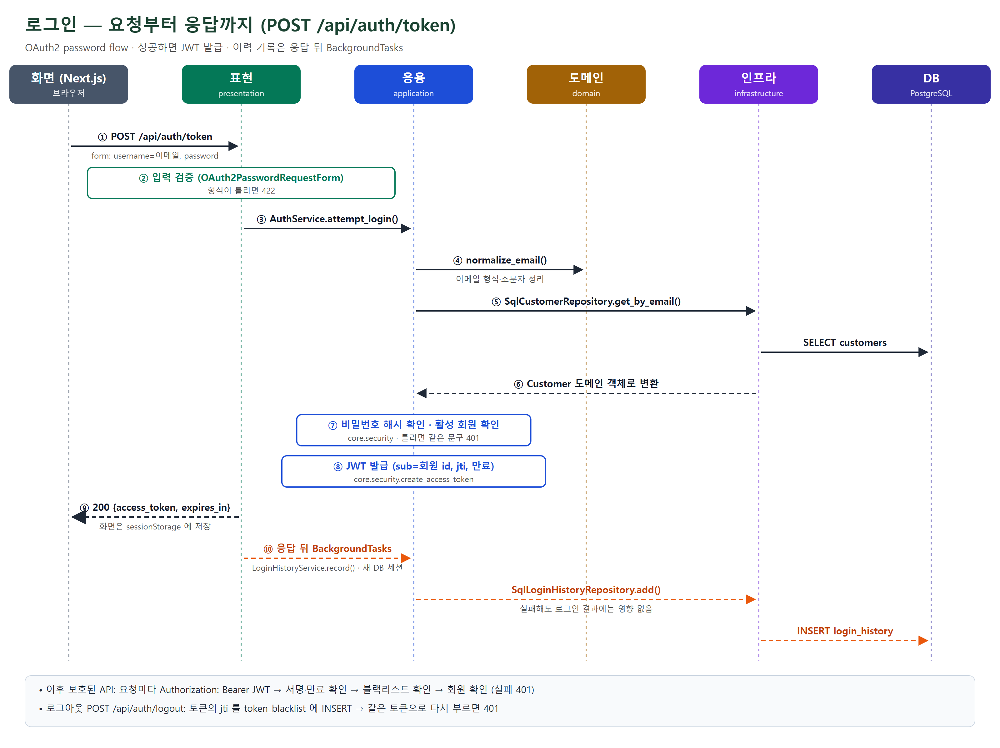 | 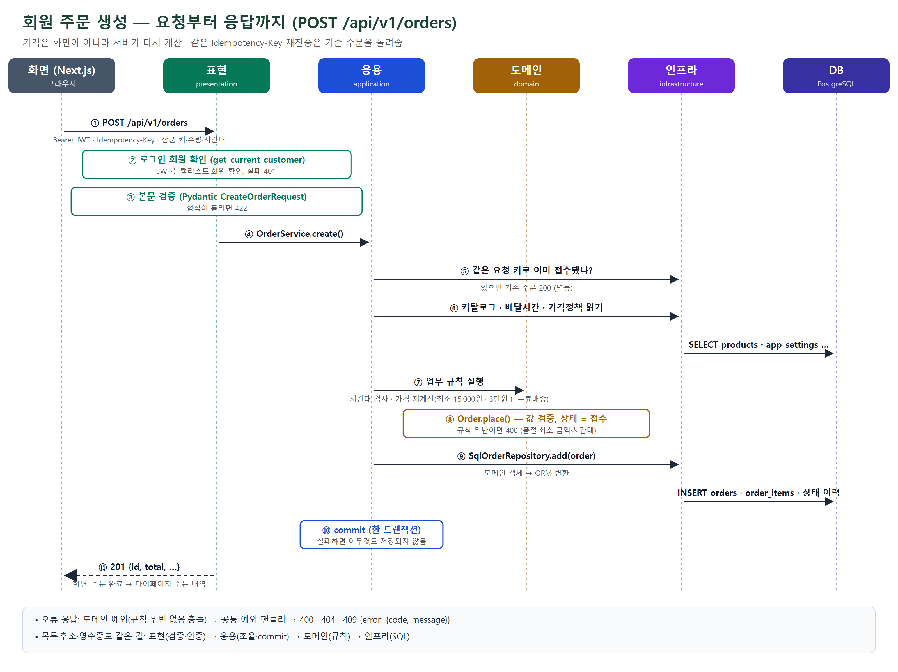 |

### 팀원별 담당 Use Case

| 담당 | Use Case (화면 → API → 업무 규칙 → DB) | 주요 코드 | 실행 기록 |
| --- | --- | --- | --- |
| A | 회원가입·로그인·로그아웃, 내 정보·배송지·로그인 이력 (`/login`, `/mypage`) | `backend/src/auth`, `backend/src/customers`, `backend/src/core` | [회원 인증 문서](backend/docs/auth.md) |
| B | 메뉴 검색·필터·페이지네이션, 나만의 볼 저장 (`/menu`, `/match`) | `backend/src/catalog`, `backend/src/bowls`, `backend/src/database.py` | 작성 예정 |
| C | 회원 주문 생성·내 주문 목록(상태·기간 필터)·취소·영수증 (`/checkout`, `/mypage` 주문 내역) | `backend/src/orders`, `features/member/client.ts`, `components/mypage/OrdersTab.tsx` | [UC-C 실행 기록](docs/uc-c-verification.md) |
| D | 관리자 주문 운영 (현재 `main`: 관리자 JWT 로그인·로그아웃) | `backend/src/admin_orders` | 작성 예정 |

### 2차 과제 요구사항 대응

| 요구사항 | 위치 |
| --- | --- |
| 인수·개발 방향 | 이 섹션의 인수 정보·변경 전후 |
| 4계층·책임 분리 | `backend/src/<기능>/{presentation,application,domain,infrastructure}`, 계층 규칙 테스트 [`tests/test_layers.py`](backend/tests/test_layers.py) |
| 순수 도메인 모델 | 예: [`orders/domain/order.py`](backend/src/orders/domain/order.py)(상태 전이·취소 규칙), [`pricing.py`](backend/src/orders/domain/pricing.py)(가격 재계산) |
| 비동기 DB·Repository | [`database.py`](backend/src/database.py), `*/infrastructure/repositories.py`, `main.py` 의 `lifespan` |
| 응용 서비스·트랜잭션 | `*/application/service.py` (예: `OrderService` 의 멱등키·commit·재시도) |
| 스키마·라우터·검색·필터·페이지네이션 | `*/presentation/`, `GET /api/v1/menus`, `GET /api/v1/orders`(상태·기간·커서), `GET /api/me/login-history` |
| OAuth2·JWT·블랙리스트 | [`core/security.py`](backend/src/core/security.py), `backend/src/auth`, 로그아웃 후 401 기록: [UC-C 실행 기록 3장](docs/uc-c-verification.md#3-api-실행-기록-정상--실패--권한--로그아웃-차단) |
| CORS·로깅 | [`main.py`](backend/src/main.py), [`core/middleware.py`](backend/src/core/middleware.py) (토큰·본문은 기록하지 않음) |
| 화면·API·DB 연동 | 위 팀원별 Use Case |
| 예외·권한 처리 | [`core/exceptions.py`](backend/src/core/exceptions.py), [`core/exception_handlers.py`](backend/src/core/exception_handlers.py) — 400·401·403·404·409·422 |
| 문서화·재실행 | 이 README 의 [시작하기](#시작하기), [backend/README](backend/README.md) |
| API 문서 | FastAPI 실행 후 http://localhost:8000/docs (Swagger UI) |

## 주요 기능

| 기능 | 사용자가 할 수 있는 일 |
| --- | --- |
| 🥗 메뉴 탐색 | 샐러드·음료 목록, 상품 상세, 재료·알레르기 정보 확인 |
| 🥑 bowl match | 재료 카드를 선택해 나만의 조합을 만들고 저장 |
| 🛒 장바구니 | 드레싱·음료 옵션 선택, 수량 변경, 최신 가격으로 합계 확인 |
| 🚚 예약 배달 체험 | 배송 정보와 수령 날짜·시간대를 선택하고 결제 흐름 체험 |
| ⭐ 상품 리뷰 | 평점 분포·정렬·더보기 확인, 리뷰 작성 및 서버 저장 |
| 👤 마이페이지 | 회원 정보·배송지·로그인 기록, 회원 주문 내역(상태·기간 필터, 취소, 영수증 받기)과 내 리뷰 확인 |
| 🌿 관리자 | 메뉴·옵션·재료·시즌·리뷰·매장 위치 관리, 이미지 업로드, 고객 화면 미리보기 |

### 고객 화면과 연결된 카탈로그

관리자가 **저장한** 메뉴 이름·가격·이미지·판매 상태와 사이트 문구를 고객 화면에서 함께 사용합니다. 같은 브라우저의 탭에는 저장 알림을 전달하고, 다른 접속자는 화면 복귀·페이지 이동 시 갱신으로 최신 상태를 확인합니다. 주기적인 카탈로그 폴링은 사용하지 않습니다.

숨김·삭제한 상품은 고객 목록에서 제외되고, 품절 상품은 담기·주문이 제한됩니다. 장바구니에 담긴 상품과 옵션의 가격도 최신 카탈로그를 기준으로 다시 계산합니다.

<details>
<summary><strong>카탈로그 연동 검증 화면 보기</strong></summary>

아래 이미지는 자동 갱신과 가격 재계산을 확인하기 위해 테스트용 모의 API 응답을 사용한 화면입니다.

| 메뉴 자동 갱신 | 장바구니 가격 재계산 |
| --- | --- |
|  |  |

</details>

## 화면 미리보기

검증 서버(https://kant2-front5-staging.dev.crasnec.com) 화면입니다. PC는 1440px, 모바일은 390px 폭입니다.

| 메인 | 상품 목록 | 상품 상세 |
| --- | --- | --- |
| 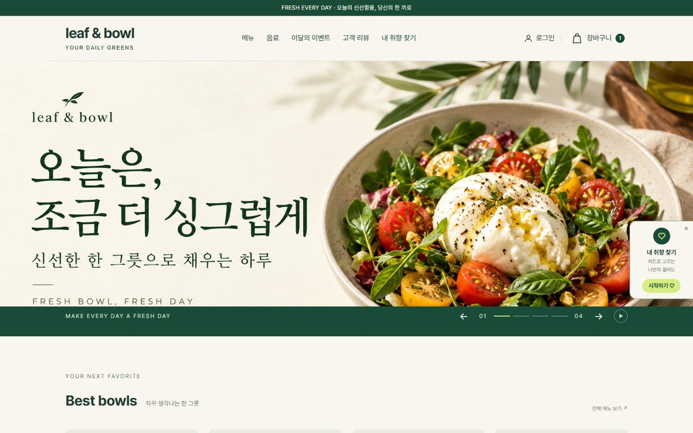 | 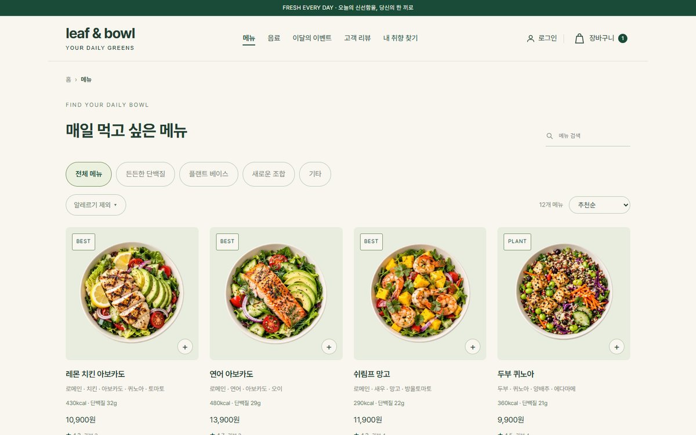 | 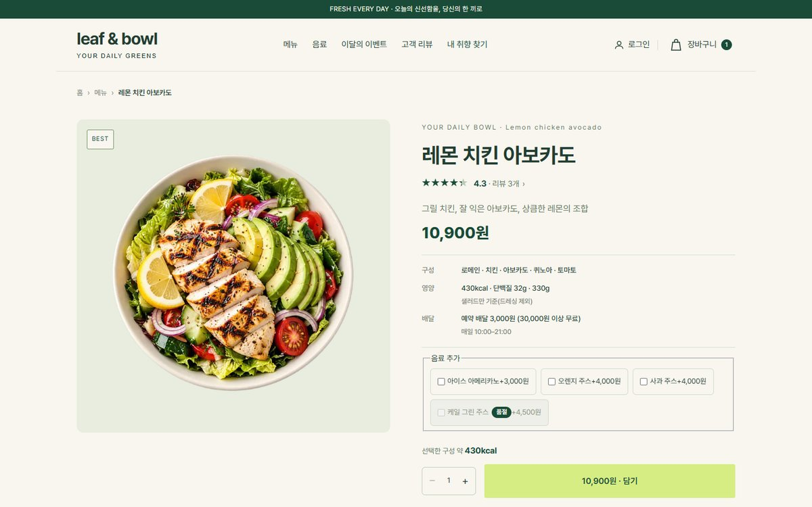 |
|  | 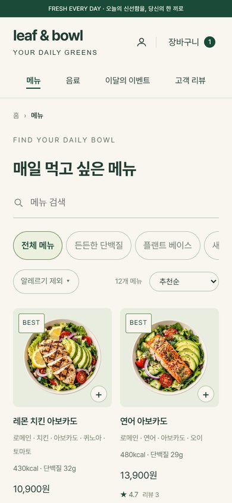 | 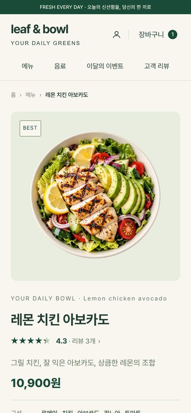 |

| 장바구니 | 주문·결제 | 이달의 이벤트 |
| --- | --- | --- |
| 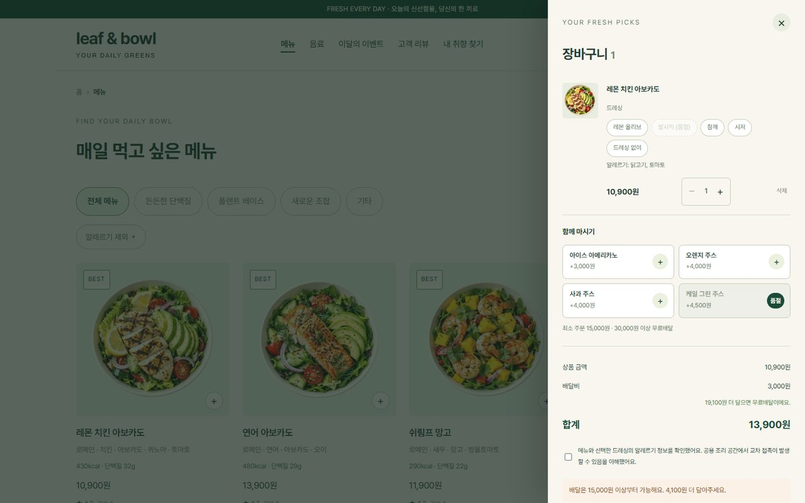 | 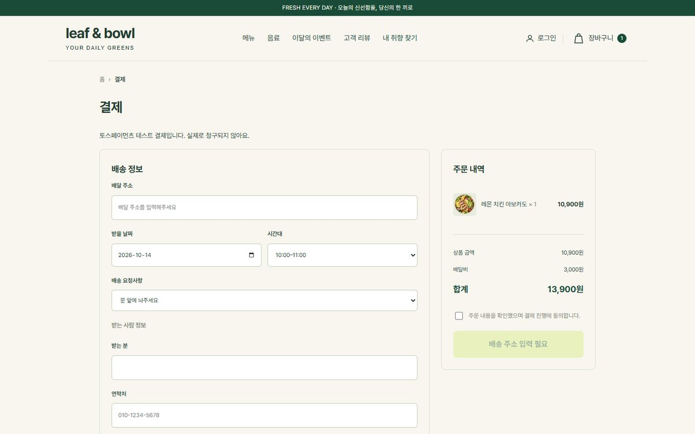 | 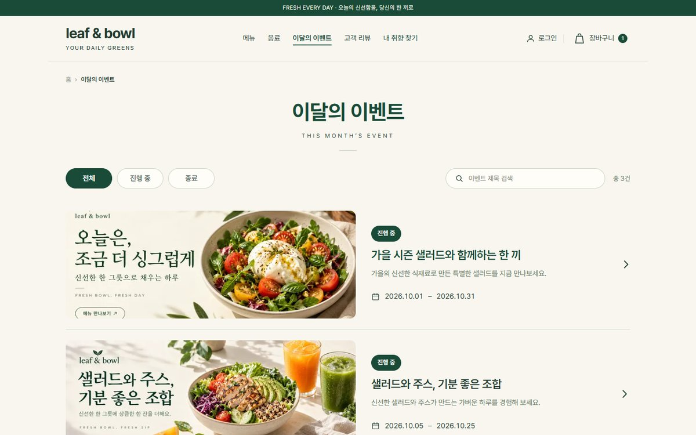 |

| 관리자 · 메뉴 관리 | 관리자 · 이달의 이벤트 관리 |
| --- | --- |
| 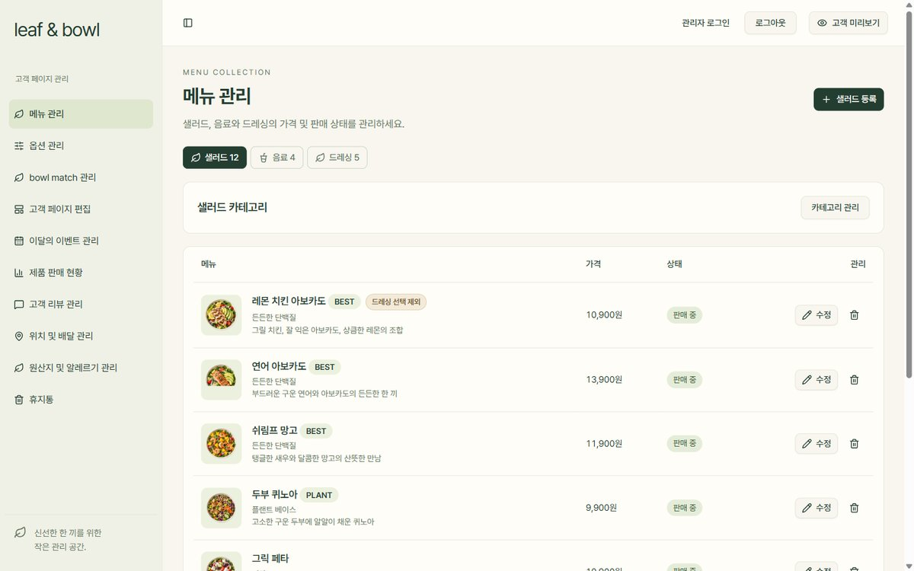 | 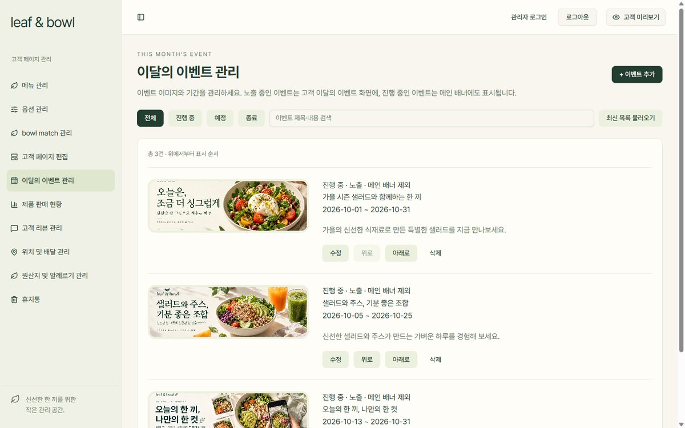 |

## 1차 과제 요구사항 대응

| 과제 요구 | 위치 |
| --- | --- |
| 상품 타입 `interface Product` | [types/product.ts](types/product.ts) (정의: [modules/catalog/customer-product.ts](modules/catalog/customer-product.ts)) |
| Mock 데이터 6개 이상 | [data/products.ts](data/products.ts) — 샐러드 12종 정적 배열 (처음엔 화면이 직접 읽었고, 지금은 같은 메뉴가 DB 초기 데이터 [db/seed.sql](db/seed.sql)에 있어 화면은 DB 에서 읽음) |
| 공통 컴포넌트 | [Header](components/Header.tsx) · [Footer](components/Footer.tsx) · [ProductCard](components/ProductCard.tsx) (Props 로 상품 전달) |
| 메인 `app/page.tsx` | [`app/(customer)/page.tsx`](app/%28customer%29/page.tsx) — 배너와 추천 상품 |
| 목록 `app/products/page.tsx` | [`app/(customer)/products/page.tsx`](app/%28customer%29/products/page.tsx) — `.map()` 으로 카드 출력 (`/menu` 와 같은 화면) |
| 상세 `app/products/[id]/page.tsx` | [`app/(customer)/products/[id]/page.tsx`](app/%28customer%29/products/%5Bid%5D/page.tsx) — 동적 라우트 (`/product/[id]` 와 같은 화면) |
| 없는 상품 ID 예외 처리 | `notFound()` → "찾으시는 메뉴가 없어요." 안내 화면 |
| `<Link>` 페이지 이동 | 헤더 메뉴·상품 카드·브레드크럼 모두 `next/link` |
| Tailwind CSS | 테마 토큰·관리자 화면은 Tailwind 유틸리티, 고객 화면은 디자인 시안을 옮긴 화면별 CSS([app/styles](app/styles)) |
| 도전: 반응형 | PC·태블릿·모바일 레이아웃 (위 모바일 캡처) |
| 도전: 장바구니 뱃지 | 담으면 헤더 장바구니 숫자 증가 |
| 도전: 배포 | GitHub Actions CI 를 통과한 커밋만 검증 서버에 자동 배포 |

필수 범위를 기준선으로 먼저 두고, 과제 제외 범위였던 DB·관리자 인증·테스트 결제는 팀 합의로 확장했습니다. 2차 과제 대응은 [2차 과제 요구사항 대응](#2차-과제-요구사항-대응)에 있습니다.

## 기술 스택

| 영역 | 사용 기술 |
| --- | --- |
| 프레임워크 | Next.js 16.4 · App Router · Route Handlers |
| UI | React 19.3 · TypeScript 5 |
| 스타일 | Tailwind CSS 4 · 화면별 CSS |
| 컴포넌트 | Radix UI · Lucide React · Sonner |
| 데이터 검증 | Zod |
| 서버 저장소 | PostgreSQL 18 · Prisma 7.10 (카탈로그·앱 설정·리뷰·주문·세션) |
| 브라우저 저장소 | 장바구니·취향 localStorage, 회원 토큰 sessionStorage |
| DB 변경 이력 | Prisma migrations · 기존 SQL 제약·뷰·트리거 보존 |
| 백엔드 API (2차) | FastAPI · Python 3.13 · uv · Pydantic · SQLAlchemy 2 비동기(asyncpg) · PyJWT · pwdlib(Argon2) |
| 검증·배포 | GitHub Actions `Frontend CI` · 개발 MCP 배포 스크립트 |

## 시작하기

### 로컬 개발

화면(Next.js)과 백엔드 API(FastAPI)를 함께 띄웁니다. 순서는 **DB 준비 → FastAPI → Next.js** 입니다.
CI와 동일한 **Node.js 22**, npm, Git, 그리고 [uv](https://docs.astral.sh/uv/)를 준비합니다. Python 3.13 은 uv 가 받아 줍니다.

**1. DB 준비** (저장소 루트)

```bash
git clone https://github.com/KANT-2/leaf-bowl.git
cd leaf-bowl
cp .env.example .env.local
# .env.local 에 DATABASE_URL 을 넣는다. BACKEND_URL 기본값은 http://127.0.0.1:8000
npm ci
npm run db:migrate   # Prisma 마이그레이션 (회원 주문 0011 포함)
npm run db:seed      # 빈 DB 일 때만. 팀 공용 DB 에는 실행하지 않는다
```

**2. FastAPI** (`backend/`, 새 터미널)

```bash
cd backend
uv sync
cp .env.example .env   # DATABASE_URL(1과 같은 DB), JWT_SECRET_KEY 를 채운다
uv run uvicorn main:app --app-dir src --reload   # http://localhost:8000/docs
```

기동할 때 `lifespan` 이 DB 연결을 확인하고 FastAPI 가 쓰는 회원·토큰 블랙리스트 등의 테이블을 준비합니다. 자세한 설정은 [backend/README](backend/README.md)를 참고합니다.

**3. Next.js** (저장소 루트, 새 터미널)

```bash
npm run dev
```

브라우저에서 [http://localhost:3000](http://localhost:3000)을 엽니다. 회원가입·로그인은 [/login](http://localhost:3000/login), 관리자 화면은 [/admin](http://localhost:3000/admin)입니다. FastAPI 가 꺼져 있으면 회원 기능(로그인·마이페이지·회원 주문)만 실패하고 비회원 흐름은 동작합니다.

`db:seed`는 실행 원본 [db/seed.sql](db/seed.sql)로 비어 있는 카탈로그를 초기화하고 배너·배송시간·가격 정책·영양정보 등의 DB 설정을 넣습니다. 기존 편집과 주문은 보존합니다. 기존 JSON을 옮길 때는 seed보다 먼저 가져오기를 실행합니다. [DB 운영 가이드](docs/postgres.md)를 참고하세요.

### 저장 경로 설정

| 환경 변수 | 기본값 | 용도 |
| --- | --- | --- |
| `DATABASE_URL` | 없음 | 앱 전용 PostgreSQL 연결 주소 |
| `ADMIN_LOGIN_ID`, `ADMIN_PASSWORD` | 없음 | `db:seed`에서 만들 관리자 계정 |
| `ADMIN_DATA_DIR` | `.data/admin` | 업로드 이미지의 영속 저장 디렉터리 |

필요하면 저장소 루트의 `.env.local`에 경로를 지정합니다.

```dotenv
ADMIN_DATA_DIR=/absolute/path/to/leaf-bowl-data
```

릴리스 디렉터리를 교체하는 배포에서는 데이터를 유지하도록 고정 절대 경로를 사용합니다. 환경 변수 파일과 `.data/`는 Git에서 제외됩니다.

### 빌드와 실행

```bash
npm run build
npm run start
```

| 명령 | 설명 |
| --- | --- |
| `npm run dev` | 개발 서버 실행 |
| `npm run lint` | ESLint 규칙 및 Prettier 스타일 검사 |
| `npm run format` | 코드 포맷 수정 |
| `npm run format:check` | 코드 포맷 검사 |
| `npx eslint --fix` | 중괄호·함수 간 빈 줄 등 린트 자동 수정 |
| `npm run build` | 운영 빌드 생성 |
| `npm run start` | 생성된 운영 빌드로 서버 실행 |
| `npx --no-install tsc --noEmit` | TypeScript 검사 |

Next.js가 생성하는 타입을 사용하므로 별도 타입 검사는 빌드 후에 실행합니다.

## 페이지 안내

| 경로 | 화면 |
| --- | --- |
| `/` | 홈 · 시즌 스페셜 · 메뉴 · 리뷰 |
| `/menu` | 샐러드 메뉴 목록 |
| `/products` | 과제 경로의 전체 상품 목록 (`/menu` 와 같은 화면) |
| `/drinks` | 음료 목록 |
| `/product/[id]` | 상품 상세와 옵션 선택 |
| `/products/[id]` | 과제 경로의 상품 상세 (`/product/[id]` 와 같은 화면) |
| `/product/[id]/reviews` | 상품별 리뷰 |
| `/reviews` | 기본 상품 리뷰(`/product/0/reviews`)로 이동 |
| `/match` | bowl match · 나만의 재료 조합 |
| `/event` | 이달의 이벤트 목록 (진행 중·종료) |
| `/login` | 체험용 로그인 |
| `/mypage` | 프로필·배송지·취향·주문 내역·내 리뷰 |
| `/checkout` | 주문·결제 (토스페이먼츠 테스트 결제) |
| `/admin` | 관리자 화면 |
| `/admin/preview` | 관리자 카탈로그 기반의 별도 고객 미리보기 |

장바구니는 고객 화면에서 열리는 드로어입니다. 기존 `/bowl-match` 주소는 `/match`로 이동합니다.

## 개발 가이드

### 컴포넌트 구조

```text
app/(customer)/layout.tsx
├── Provider (카탈로그 · 장바구니 · 로그인 · 리뷰 · 알림)
├── Header ── HeaderNav · CartButton · AccountLink
├── page.tsx (메인) ── CustomerHome
│   └── HeroCarousel · ProductCard × 4 · CustomerSeasons · ReviewRotator · MatchFloat
├── menu · products ── MenuSection ── ProductCard × n
├── product/[id] · products/[id] ── CustomerProductPage
│   └── ProductDetail · ProductRating · ProductReviewsPreview
├── match ── BowlMatch
├── checkout ── CheckoutView
├── event ── CustomerEvents
├── CartDrawer
└── Footer
app/admin ── AdminWorkspace ── 메뉴 · 옵션 · bowl match · 고객 페이지 · 이벤트 · 판매 · 리뷰 · 배달 관리
```

### 프로젝트 구조

```text
leaf-bowl/
├── app/
│   ├── (customer)/       # 고객 페이지와 루트 레이아웃
│   ├── admin/            # 관리자 페이지와 루트 레이아웃
│   ├── api/              # 카탈로그·상품·리뷰·이미지 API
│   └── styles/           # 고객 화면별 스타일
├── components/           # 고객 컴포넌트·Provider·관리자 UI
├── modules/              # 카탈로그·주문·프로필·장바구니의 계약과 업무 규칙
├── application/          # 트랜잭션 조합·서비스 생성·서버 조회
├── infrastructure/       # PostgreSQL·HTTP·브라우저 저장소 어댑터
├── features/             # 화면별 표시·입력·클라이언트 요청 로직
├── types/                # 과제 경로의 공통 타입 (Product)
├── data/                 # 과제 경로의 상품 Mock 데이터 (테스트·카탈로그 이관에 사용)
├── seed/                 # SQL 초기화·명시적 JSON 이관 전용
├── public/               # 상품·재료 이미지
├── prisma/               # DB 모델·마이그레이션·seed
├── db/                   # 기존 PostgreSQL 설계 SQL
├── tests/                # 카탈로그·브라우저 검증
├── docs/                 # 설계·연동 문서와 검증 스크린샷
├── ops/                  # 배포 스크립트·운영 문서·테스트
└── .github/workflows/    # Frontend CI
```

코드 스타일은 들여쓰기 2칸, 쌍따옴표, 세미콜론, 줄 폭 120자, LF로 통일합니다. `if`·`else`·`for`·`while`·`do` 본문에는 중괄호를 반드시 사용합니다. 인접한 함수 선언(화살표 함수·export 함수 포함)과 클래스 메서드 사이에는 빈 줄을 한 줄 두고, 연속 빈 줄 두 개 이상은 허용하지 않습니다. 긴 문자열·URL처럼 나누기 어려운 값은 120자를 넘을 수 있습니다.

`npx eslint --fix`로 중괄호·함수 간 간격을 수정한 다음 `npm run format`으로 포맷을 정리합니다. `npm run lint`는 두 검사 모두 수행하며 스타일 위반도 기존 CI에서 실패합니다. 생성 코드·빌드 결과·배포 상태·사진/정적 자산·문서는 자동 포맷 대상에서 제외합니다. SQL·Prisma 스키마·Python은 Prettier 포맷 대상이 아닙니다.

[모듈 경계와 데이터 흐름](docs/architecture.md)에 책임·의존성 규칙과 변경 시 확인할 항목을 정리했습니다. `npm run lint`와 `npm test`가 경계 위반·순환 의존성·클라이언트의 서버 코드 참조를 검사합니다.

Tailwind 색상·글꼴 토큰은 `app/styles/theme.css`에서 공유합니다. 기본 스타일은 `base`, 화면별 CSS는 `components` 레이어에 두어 Tailwind 유틸리티로 크기·여백을 조정할 수 있게 합니다. 고객의 기존 리셋과 관리자 Preflight는 각 루트 레이아웃에서 유지합니다. 공통 컴포넌트의 변형과 화면이 요구하는 크기는 컴포넌트 클래스에서 지정합니다.

### 데이터는 어디에 저장되나요?

| 데이터 | 현재 저장 위치 | 특징 |
| --- | --- | --- |
| 고객·관리자 공통 카탈로그와 리뷰 | PostgreSQL | `application/catalog.ts`에서 조회·저장, 잠금·`revision`으로 저장 충돌 확인 |
| 배너·배송시간·가격·영양·추천·편집 선택지 | PostgreSQL `app_settings` | 런타임 정적 기본값 없이 검증된 DB 설정 사용 |
| 서버 주문·주문 항목·상태 이력 | PostgreSQL | 비회원 세션별 조회, 재전송·상태 변경 충돌 방지 |
| 관리자 계정·관리자/비회원 세션 | PostgreSQL | 비밀번호·토큰 해시와 만료 시각 보존 |
| 회원 계정·배송지·로그인 이력 (2차) | PostgreSQL `customers` · `customer_addresses` · `login_history` (FastAPI) | 비밀번호는 Argon2 해시, 로그인 이력은 응답 뒤 BackgroundTasks 로 기록 |
| 회원 주문 (2차) | PostgreSQL `orders.customer_id` (FastAPI) | 회원 기준 조회·상태·기간 필터·취소, 상태 이력 기록 |
| 로그아웃한 JWT (2차) | PostgreSQL `token_blacklist` (FastAPI) | 같은 토큰을 다시 쓰면 401 |
| 회원의 나만의 볼 (2차) | PostgreSQL `bowl_recipes` · `bowl_recipe_ingredients` (FastAPI) | 로그인한 회원의 조합 저장·조회·삭제 |
| 관리자 업로드 이미지 | 서버의 `images/` 디렉터리 | `ADMIN_DATA_DIR` 아래 보관, PNG·JPEG·WebP 및 파일당 5MB 제한 |
| 장바구니 | localStorage · `bb-cart` | 브라우저에 보존하고 최신 카탈로그로 가격·판매 가능 여부 계산 |
| 화면 표시용 사용자 정보·취향 | localStorage · `bb-user` | 1차의 모의 저장소. 2차부터 회원 정보·배송지 원본은 서버, 회원 토큰은 sessionStorage `lb-member-token` |
| 과거 체험 주문 내역 | localStorage · `bb-orders` | 이전 기록을 보존하며 새 DB 주문과 함께 표시 |
| 저장한 bowl match 조합 | localStorage · `bm-recipe` | 저장한 조합을 보존하고 카드 진행 상태는 메모리에서 관리 |
| 작성한 리뷰의 로컬 기록 | localStorage · `bb-user-reviews` | 서버 저장 리뷰와 연계해 내 리뷰 식별·기존 기록 이관에 사용 |
| 개별 상품 조회·수정 API | PostgreSQL 공통 카탈로그 | 고객·관리자 화면 및 주문 가격과 같은 저장소 |

DB 구조는 [`prisma/schema.prisma`](prisma/schema.prisma), 변경 이력은 `prisma/migrations`에서 관리합니다. 기존 SQL의 CHECK·IDENTITY·뷰·트리거를 baseline에 보존했습니다. 실행과 기존 JSON 이관은 [DB 운영 가이드](docs/postgres.md)를 참고합니다.

### 구현된 API

| 메서드 | 경로 | 용도 |
| --- | --- | --- |
| `GET` | `/api/catalog` | 고객용 카탈로그 조회 |
| `GET`, `PUT` | `/api/admin/catalog` | 관리자 카탈로그 조회·전체 저장 |
| `POST` | `/api/reviews` | 고객 리뷰 작성 |
| `POST` | `/api/admin/images` | 관리자 이미지 업로드 |
| `GET` | `/api/admin/images/[key]` | 업로드 이미지 조회 |
| `GET` | `/api/products` | 공통 DB 상품 목록·분류별 조회 |
| `GET` | `/api/products/[id]` | 공통 DB 개별 상품 조회 |
| `PATCH` | `/api/admin/products/[id]` | 관리자 인증 후 공통 DB 상품 일부 수정 |

위 표는 Next.js API 입니다. 회원·회원 주문·메뉴 검색·나만의 볼 API(FastAPI)는 [backend/README](backend/README.md)와 Swagger(http://localhost:8000/docs)에 있습니다.

개별 상품 API도 공통 카탈로그를 사용합니다. 오류 응답은 카탈로그 계열의 `{ "error": "메시지" }`와 개별 상품 API의 `{ "message": "메시지" }`로 구분됩니다.

### 변경 사항 검증

기본 검증은 저장소 루트에서 아래 순서로 실행합니다.

```bash
npm ci
npm run db:validate
npm test
npm run test:db
npm run lint
npm run build
npx --no-install tsc --noEmit
```

카탈로그 저장·이관·옵션·리뷰를 수정할 때는 `npm test`와 `npm run test:db`를, CI/CD 스크립트를 수정할 때는 `python3 -m unittest discover -s ops -p 'test_*.py' -v`를 추가로 실행합니다. 브라우저 연동 확인 절차는 [관리자·고객 연동 문서](docs/admin-integration.md)에 정리되어 있습니다.

## 배포와 협업

GitHub Actions의 **Frontend CI**는 PR과 `main`·`production` push에서 의존성 설치, 린트, 배포 스크립트 테스트, 빌드, 타입 검사를 수행합니다. 개발 MCP 배포 프로세스는 해당 브랜치 최신 커밋의 CI 성공을 확인한 뒤 서버를 교체합니다.

| 브랜치 | 역할 | 배포 환경 |
| --- | --- | --- |
| 작업 브랜치 | 기능·수정·문서 작업 | `main` 대상 PR로 검토 |
| `main` | 개발 결과 통합·검증 | 비공개 검증 앱 · 포트 3100 |
| `production` | 운영 배포 기준 | 공개 운영 앱 · 포트 3200 |

작업은 **이슈 → 작업 브랜치 → PR** 순서로 진행합니다. 일반 작업 PR은 리뷰·CI를 통과한 뒤 Squash merge하고, `main → production` 배포와 `production → main` 동기화에는 Merge commit을 사용합니다.

브랜치 보호·리뷰·Hotfix 규칙은 [AGENTS.md](AGENTS.md), 배포 준비·상태 확인·복구 방법은 [운영 가이드](ops/README.md)를 따릅니다.

## 관련 문서

| 문서 | 내용 |
| --- | --- |
| [저장소 작업 지침](AGENTS.md) | 이슈·계획·브랜치·PR·코드리뷰 규칙 |
| [관리자·고객 연동](docs/admin-integration.md) | 공통 카탈로그, 데이터 이관, 브라우저 검증 절차 |
| [DB 설계](docs/db-design.md) | PostgreSQL ERD, 테이블 매핑, 트랜잭션 계약 |
| [DB 운영](docs/postgres.md) | DB 설정·초기화·JSON 이관·테스트·배포 |
| [배포·운영](ops/README.md) | 개발 MCP 배포, CI 게이트, 로그와 복구 |
| [백엔드 (FastAPI)](backend/README.md) | 실행·가상환경·DB·테스트, 4계층 구조, API 목록 |
| [회원 인증](backend/docs/auth.md) | OAuth2·JWT·블랙리스트 로그아웃 |
| [UC-C 실행 기록](docs/uc-c-verification.md) | 회원 주문의 화면·API·DB·실패·로그아웃 차단 실행 결과 |

---

<p align="center"><strong>FRESH EVERY DAY</strong><br />오늘의 신선함을, 당신의 한 끼로.</p>
