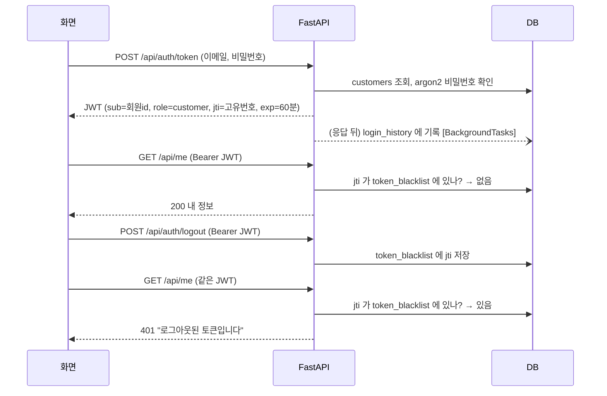

# 회원 인증 문서 (UC-A · 담당 황수아)

leaf & bowl 2차 프로젝트에서 FastAPI 가 맡은 **고객 회원 인증**과 그 위의 **내 정보·배송지·로그인 기록**을 설명합니다.
앞부분은 팀원이 기능을 만들 때 쓰는 방법, 뒷부분은 발표·리뷰용 설명입니다.

---

## 1. 인수 전 → 인수 후

| 항목 | 인수 전 (원본) | 인수 후 (이번 작업) |
| --- | --- | --- |
| 고객 로그인 | 모의 로그인. 비밀번호 검사 없음 | 회원가입·로그인 (OAuth2 password, JWT) |
| 회원 정보 | 회원 테이블 없음 | `customers` 테이블, 비밀번호는 argon2 해시 |
| 로그아웃 | 브라우저 상태만 지움 | 토큰 고유번호(jti)를 `token_blacklist` 에 등록 → 같은 토큰 재사용 시 **401** |
| 이름·전화번호 | 브라우저 localStorage(`bb-user`) | `PATCH /api/me` 로 DB 저장 |
| 배송지 | 브라우저 localStorage(`bb-user`) | `customer_addresses` 테이블, API 5개 |
| 로그인 기록 | 없음 | `login_history` 테이블, 검색·필터·페이지네이션 |

기존 방문자 세션(`lb_guest`, 비회원 주문)과 관리자 세션(`lb_admin`, Next.js `/admin`)은 그대로 두고, 회원 JWT 를 새로 추가했습니다.

---

## 2. 팀원용: 로그인한 사람만 쓰게 하기

```python
from fastapi import Depends
from core.dependencies import CurrentCustomer, get_current_customer

@router.get("/api/me/bowls")
async def list_my_bowls(customer: CurrentCustomer = Depends(get_current_customer)):
    ...  # customer.id 로 "본인 데이터만" 조회한다. 회원 id 를 요청 값으로 받지 않는다.
```

`get_current_customer` 가 하는 일 (순서대로, 하나라도 실패하면 **401**):

1. `Authorization: Bearer <토큰>` 이 있는지
2. 서명·만료·필수 값(sub, role, jti, exp) 확인, `role` 이 `customer` 인지
3. 토큰 jti 가 블랙리스트(로그아웃)에 있는지
4. 회원이 존재하고 탈퇴하지 않았는지

관리자 API 는 `Depends(require_admin)` 을 씁니다. 관리자 토큰 발급은 D(관리자) 기능에서
`security.create_access_token(str(admin_id), "admin", {"login_id": ...})` 로 만들고, 고객 토큰으로 관리자 API 를 부르거나
그 반대로 부르면 401 입니다. 관리자 계정 비활성 여부 확인은 관리자 모듈의 의존성에서 합니다
(공통 인증이 관리자 테이블에 의존하지 않도록).

### 오류는 이렇게 던진다

```python
from core.exceptions import BusinessRuleViolation, Conflict, Forbidden, NotFound
raise NotFound("배송지를 찾을 수 없습니다.")
```

| 예외 | 상태 | 예 |
| --- | --- | --- |
| 요청 형식 오류 (Pydantic) | 422 | 이메일 형식, 길이 초과 |
| `BusinessRuleViolation` | 400 | 배송지 6개째, 약한 비밀번호 |
| `Unauthorized` | 401 | 토큰 없음·만료·로그아웃한 토큰 |
| `Forbidden` | 403 | 권한 없음 |
| `NotFound` | 404 | 없는 리소스, **다른 회원의 리소스**(존재 여부를 드러내지 않음) |
| `Conflict` | 409 | 이미 가입된 이메일 |

모든 오류 응답 모양: `{"error": {"code": "...", "message": "..."}}`

### 화면(Next.js)에서 부르기

`features/member/client.ts` 의 `backendRequest(path, { auth: true })` 를 씁니다.
토큰을 자동으로 붙이고, 401 이면 저장된 토큰을 지우고 `MemberAuthError` 를 던집니다(화면은 로그인으로 보냄).
토큰은 메모리와 sessionStorage 에 둡니다(#194). 화면은 `/backend/...` 로 부르고 Next.js 가 FastAPI 로 넘깁니다.

---

## 3. API 목록

| 메서드 | 경로 | 설명 | 인증 |
| --- | --- | --- | --- |
| POST | `/api/auth/signup` | 회원가입 (email, password, name, phone?) | - |
| POST | `/api/auth/token` | 로그인 (form: username=이메일, password) → `access_token` | - |
| POST | `/api/auth/logout` | 토큰을 블랙리스트에 등록 (204) | 고객 |
| GET | `/api/me` | 내 정보 | 고객 |
| PATCH | `/api/me` | 이름·전화번호 수정 (보낸 항목만, phone 빈 값은 삭제) | 고객 |
| GET | `/api/me/login-history` | 내 로그인 기록 (`result`, `from`, `to`, `page`, `size`) | 고객 |
| GET | `/api/me/login-history.csv` | 같은 조건의 기록 전체를 CSV 파일로 (StreamingResponse) | 고객 |
| GET · POST | `/api/me/addresses` | 내 배송지 목록 · 추가 | 고객 |
| PATCH · DELETE | `/api/me/addresses/{id}` | 배송지 수정 · 삭제 | 고객 |
| POST | `/api/me/addresses/{id}/default` | 기본 배송지로 지정 | 고객 |

배송지 변경 API 는 바뀐 뒤의 **전체 목록**을 돌려줍니다. 자세한 요청·응답은 서버 실행 후 `/docs`(Swagger).

---

## 4. 업무 규칙 (domain 에 있는 것)

**회원** (`customers/domain/customer.py`)
- 비밀번호 8~64자, 영문과 숫자 모두 포함
- 이메일은 소문자로 정리, 이름 1~50자, 휴대폰 `010-0000-0000` 형식으로 정리
- 탈퇴 회원은 로그인 불가 (응답은 일반 로그인 실패와 같은 문구)

**배송지** (`customers/domain/address.py`)
- 최대 5개, 첫 배송지는 자동으로 기본
- 기본 배송지는 하나뿐 (새로 지정하면 기존 해제) — DB 부분 유니크 인덱스로도 강제
- 기본 배송지를 지우면 남은 것 중 가장 먼저 만든 배송지가 기본
- 변경할 때 회원 행을 잠가(FOR UPDATE) 동시에 추가·변경해도 규칙이 깨지지 않음

**로그인 기록** (`auth/domain/login_history.py`)
- 성공이면 실패 이유 없음, 실패면 이유 있음(`wrong_password`, `withdrawn`)
- 조회: 페이지 1 이상, 크기 1~50, 시작일 ≤ 종료일, 기간 최대 90일, 날짜는 한국 시간(+09:00) 기준
- 가입되지 않은 이메일로 한 시도는 기록하지 않음 (응답도 같아서 가입 여부가 드러나지 않음)

---

## 5. 동작 원리

### 로그인 → 보호된 요청 → 로그아웃 → 401



JWT 는 서버에 저장하지 않는 방식이라 그대로는 무효화할 수 없습니다. 그래서 토큰마다 고유번호(jti)를 넣고,
로그아웃하면 그 번호를 블랙리스트에 적어 두고 매 요청마다 확인합니다. 블랙리스트에는 토큰 원문이 아니라
번호와 만료 시각만 저장하고, 만료가 지난 번호는 로그아웃 때 정리합니다.

### 4계층 (요청 하나가 지나가는 길)

| 계층 | 역할 | 예 (배송지 추가) |
| --- | --- | --- |
| presentation | 요청 형식 검사, 인증, 예외 → HTTP | `address_router.py`: `AddressRequest` 검사, `get_current_customer` |
| application | 흐름과 트랜잭션 | `AddressService.add`: 잠금 조회 → 규칙 → 저장 → 커밋 |
| domain | 업무 규칙 (순수 파이썬) | `AddressBook.add`: 5개 제한, 첫 배송지 기본 |
| infrastructure | DB ↔ 도메인 객체 변환 | `SqlAddressRepository.load_book / save_book` |

의존 방향은 presentation → application → domain ← infrastructure 이고, domain 은 FastAPI·SQLAlchemy 를 import 하지 않습니다.

---

## 6. 테이블 (FastAPI 소유, 서버 기동 시 없으면 생성 · RLS 활성화)

| 테이블 | 주요 컬럼 |
| --- | --- |
| `customers` | id, email(유니크), password_hash, name, phone, status |
| `token_blacklist` | jti(PK), expires_at, revoked_at |
| `login_history` | customer_id(→customers, 삭제 시 함께 삭제), result, reason, user_agent, created_at |
| `customer_addresses` | customer_id(→customers, 삭제 시 함께 삭제), label, recipient_name, phone, address, detail, request_note, is_default |

Prisma 가 관리하는 기존 테이블(상품·주문 등)은 건드리지 않습니다. RLS 는 Supabase Data API(anon 키)로 이 테이블들이
외부에 노출되지 않게 하려고 켭니다. FastAPI 는 테이블 소유자로 접속해 영향이 없습니다.

---

## 7. 보안·개인정보 처리

- 비밀번호는 argon2 해시만 저장. 없는 이메일도 같은 시간이 걸리게 비교해 가입 여부를 숨김
- 요청 로그에는 메서드·경로·상태·처리 시간만 남김 (토큰·비밀번호·본문·쿼리스트링 제외)
- 로그인 기록에 비밀번호·IP 를 저장하지 않음
- 회원 id 는 토큰에서만 가져와, 요청 값으로 남의 데이터를 고를 방법이 없음

---

## 8. 직접 확인하는 방법 (시연 순서)

1. `cd backend` → `uv run uvicorn main:app --app-dir src --reload` → http://localhost:8000/docs
2. `POST /api/auth/signup` 으로 가입
3. 오른쪽 위 **Authorize** 에 이메일·비밀번호 입력
4. `GET /api/me` → 200
5. `PATCH /api/me`, `POST /api/me/addresses` → 저장 확인, `GET /api/me/login-history` → 기록 확인
6. `POST /api/auth/logout` → 204
7. `GET /api/me` 다시 실행 → **401 "로그아웃된 토큰입니다"**

자동 테스트: `uv run pytest` (DB 없이 메모리 저장소로 실행)

---

## 9. 문제 해결 기록

| 문제 | 원인 | 해결 |
| --- | --- | --- |
| Supabase 연결 시 `DLL load failed` | Windows 스마트 앱 컨트롤이 최신 asyncpg(0.32) 바이너리 차단 | 보안 설정은 두고 asyncpg 0.30.0 고정 |
| 복사한 DB 주소로 접속 실패 | `postgresql://`·따옴표 형식이라 비동기 드라이버를 못 찾음 | `postgresql+asyncpg://` 자동 변환, 따옴표 무시 |
| `Asia/Seoul` 시간대 로드 실패 | Windows 에 tz 데이터 없음 | 고정 +09:00 사용 (orders 와 같은 방식) |
| 로그인 실패 기록이 안 남음 | 예외로 401 을 내면 BackgroundTasks 가 실행되지 않음 | 실패 응답을 직접 만들어 반환 |
| PR CI 실패 | 클라이언트 테스트가 날짜를 10/24 로 고정, 토큰 만료는 실제 시계로 판단 | `NOW = Date.now()` 로 수정 |

---

## 10. 도전 B · BackgroundTasks 증거 (로그인 기록)

로그인 기록은 **응답을 먼저 보낸 뒤** `BackgroundTasks` 로 저장합니다. 기록 저장이 느리거나 실패해도 로그인 자체는 영향을 받지 않게 하려는 것입니다.

| 단계 | 하는 일 | 코드 |
| --- | --- | --- |
| ① 로그인 처리 | 비밀번호 확인 → 토큰 발급(또는 401) | `auth/presentation/router.py` |
| ② 작업 예약 | `background_tasks.add_task(recorder, attempt)` | 같은 파일 |
| ③ 응답 전송 | 200 토큰 / 401 오류 | — |
| ④ 이력 저장 | **새 DB 세션**으로 `login_history` 에 INSERT | `auth/presentation/login_history.py` `record_in_new_session` |

- 요청용 세션은 응답과 함께 닫히므로 ④는 `database.new_session()` 으로 따로 연다
- 실패한 로그인도 기록하려고 401 을 예외가 아닌 `JSONResponse` 로 반환한다 (예외로 끝나면 예약한 작업이 실행되지 않음)
- 가입되지 않은 이메일은 회원 id 가 없으므로 기록하지 않는다

### 실행 순서 증거

**자동 테스트** `tests/test_background_tasks.py`
ASGI 단계에서 "응답 본문 전송 완료" 시점과 "이력 저장" 시점을 같은 목록에 적어 비교한다.

| 테스트 | 확인 내용 |
| --- | --- |
| `test_history_is_saved_after_response_is_sent[200]` | 성공 로그인: `["응답 전송 완료", "이력 저장(success)"]` |
| `test_history_is_saved_after_response_is_sent[401]` | 실패 로그인: `["응답 전송 완료", "이력 저장(failure)"]` |
| `test_unknown_email_schedules_no_background_task` | 없는 이메일: 응답만 있고 저장 작업 없음 |

**실제 서버 로그** (Supabase 연결, 2026-10-26, 테스트 계정은 확인 후 삭제)

```text
16:10:08,475 INFO app.request          POST /api/auth/token 200 62.2ms      ← 응답 완료
16:10:08,623 INFO app.login_history    로그인 이력 기록 완료(BackgroundTasks): result=success 로그인 시도 후 148.9ms
16:10:08,816 INFO app.request          POST /api/auth/token 401 75.1ms      ← 응답 완료
16:10:08,847 INFO app.login_history    로그인 이력 기록 완료(BackgroundTasks): result=failure 로그인 시도 후 31.5ms
```

요청 로그(응답 처리 시간 62ms)가 먼저 찍히고, 그 뒤에 이력 저장 완료 로그가 찍힌다. DB 에도 `success`, `failure(wrong_password)` 두 행이 저장된 것을 확인했다.

### 실패 처리 증거

| 테스트 | 상황 | 결과 |
| --- | --- | --- |
| `test_login_still_succeeds_when_history_saving_fails` | DB 가 없어 이력 저장이 반드시 실패 | 로그인은 **200 + 토큰**, `로그인 이력 기록 실패` 로그 1건(원인 예외 포함), 완료 로그 없음, 로그에 비밀번호 없음 |

`record_in_new_session` 은 예외를 잡아 `logger.exception` 으로만 남기고 다시 던지지 않는다. 응답은 이미 나간 뒤라 사용자는 영향이 없고, 운영자는 로그로 원인을 확인한다.

### 직접 확인하기

1. 서버 실행 후 Swagger 에서 로그인 한 번, 틀린 비밀번호로 한 번
2. 서버 로그에서 `app.request POST /api/auth/token` 다음 줄에 `로그인 이력 기록 완료(BackgroundTasks)` 가 찍히는지 확인
3. `GET /api/me/login-history` 로 두 건(성공·실패) 확인
4. 자동 테스트: `uv run pytest tests/test_background_tasks.py -v`

### CSV 다운로드 (StreamingResponse)

마이페이지 **로그인 기록** 탭의 **[파일로 받기 (CSV)]** → `GET /api/me/login-history.csv`.
지금 조회한 조건(성공·실패, 기간) 그대로, 페이지 구분 없이 전체를 한 파일로 받습니다.

| 단계 | 하는 일 | 코드 |
| --- | --- | --- |
| ① 조건 검사 | `LoginHistoryQuery` 로 기간 규칙 확인 (위반이면 **응답을 시작하기 전에** 400) | `presentation/login_history.py` |
| ② 나눠 읽기 | 50건씩 DB 에서 읽어 한 건씩 넘김. 내보내는 중 새 로그인이 기록돼도 같은 행이 두 번 나오지 않음 | `application/login_history.py` `export_mine` |
| ③ 한 줄씩 전송 | 머리글 → 행 하나씩 `StreamingResponse` 로 흘려보냄 (`transfer-encoding: chunked`) | `_csv_chunks` |
| ④ 완료 로그 | `로그인 이력 CSV 내보내기 완료(StreamingResponse): rows=N` | 같은 함수 |

- 엑셀에서 한글이 깨지지 않게 UTF-8 BOM 을 붙이고, 시간은 한국 시간, 결과·실패 이유는 한국어로 쓴다
- 기기 정보는 사용자가 보낸 값이라 `=`·`+`·`-`·`@` 로 시작하면 앞에 `'` 를 붙여 엑셀 수식으로 실행되지 않게 한다 (CSV 수식 주입 방지)
- `Cache-Control: no-store`, 회원 id 는 토큰에서만 가져와 남의 기록은 받을 수 없다

| 테스트 (`tests/test_login_history_csv.py`) | 확인 내용 |
| --- | --- |
| `test_body_is_sent_in_many_chunks` | 기록 31건 → 본문이 **32조각**(머리글 1 + 행 31)으로 나뉘어 전송 |
| `test_export_reads_every_page_newest_first` | 50건 단위 3쪽을 모두 읽고 최신순, 다른 회원 기록 제외 |
| `test_export_skips_rows_repeated_by_new_login_during_export` | 내보내는 중 새 로그인이 생겨도 중복 없음 |
| `test_download_returns_only_my_history_as_csv_file` | 파일 이름·형식·BOM·머리글, 내 기록만, 비밀번호 없음 |
| `test_download_applies_same_filters_as_list` · `test_invalid_period_is_rejected_before_streaming` | 목록과 같은 조건, 잘못된 기간은 400 |
| `test_csv_row_blocks_formula_injection` | `=HYPERLINK(...)` → `'=HYPERLINK(...)` |

실제 서버 확인 (2026-10-26, 테스트 계정은 확인 후 삭제): 응답 헤더 `transfer-encoding: chunked`, 파일 `leafbowl-login-history-20261026.csv`

```text
일시(한국 시간),결과,실패 이유,기기 정보
2026-10-26 17:25:32,성공,,curl/8.21.0
2026-10-26 17:25:31,실패,비밀번호 불일치,'=HYPERLINK(evil)
```
