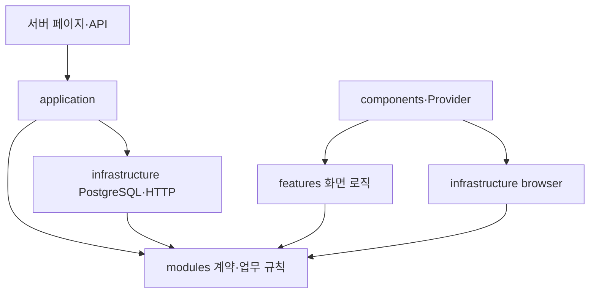

# 모듈 경계와 데이터 원본

이 문서는 현재 구현을 설명한다. 카탈로그·리뷰·주문·세션·운영 설정은 PostgreSQL에서 읽는다. 초기 데이터는 명시적 초기화·이관에만 사용한다. 같은 데이터를 고객·관리자·주문 코드에 각각 복사하지 않는다.

## 책임과 의존성

| 위치 | 책임 | 허용하는 의존성 |
| --- | --- | --- |
| `modules/` | 업무 계약, 입력 검증, 상태 변경, 가격 계산, 공통 조회 모델 | 다른 업무 계약·순수 함수, Zod, 서버 업무의 Node 암호화 |
| `application/` | 서비스 생성, 서버 조회, 카탈로그 트랜잭션 조합 | 업무 모듈과 인프라 어댑터 |
| `infrastructure/` | PostgreSQL, HTTP, 브라우저 저장소 구현 | 업무 계약과 외부 라이브러리; 애플리케이션·화면 구현 금지 |
| `features/` | 화면별 표시·입력·요청·리뷰 재시도 | 업무 모듈과 브라우저 어댑터 |
| `components/` | 렌더링, 상호작용, Provider의 상태 구독·조합 | 화면 기능, 업무 계약, 브라우저 어댑터 |
| `app/` | Next.js 페이지·라우트·요청 진입점 | 화면 조합 또는 서버 애플리케이션·HTTP 어댑터 |
| `seed/` | SQL 초기화와 이전 JSON의 명시적 이관 | 업무 계약, DB 어댑터, 레거시 변환 자료 |
| `tests/fixtures/` | 메모리 주문 어댑터·과거 파일 저장소·검증용 설정 | 테스트에서만 사용 |

`lib`, 초기 상품 `data`, 타입만 모은 `types`를 없애고 기능 소유 모듈에 계약을 둔다. 별도 기반 클래스·범용 Repository·서비스 locator를 추가하지 않는다. 주문과 인증처럼 교체 가능한 저장소가 필요한 기능은 인터페이스를 두고, 단순 카탈로그 조회는 애플리케이션 함수와 트랜잭션으로 구성한다.

ESLint는 업무 모듈의 UI·DB·프레임워크 import와 인프라의 역방향 import를 차단한다. 화면에서 서버 애플리케이션·DB 어댑터를 가져오는 것도 차단한다. 운영 코드 전체에서 `seed`·`tests` import를 금지한다. `tests/module-boundaries.test.cjs`는 상대 경로·alias·타입·동적 import까지 확인하고, 런타임 순환과 클라이언트에서 서버 전용 모듈로 이어지는 경로를 검사한다. 새 모듈도 이 검사에 자동 포함된다.

## 카탈로그와 설정

- `modules/catalog/schema.ts`는 고객·관리자·주문이 공유하는 계약이다. 관리자 표시 함수나 초기 데이터에 의존하지 않는다.
- `modules/catalog/state.ts`는 입력과 현재 DB 상태로 새 상태를 계산한다. 생성 시각은 호출자가 전달한다. 생략한 선택 필드는 현재 저장 상태를 보존하고, 명시한 빈 배열은 빈 상태로 유지한다. 삭제 리뷰 ID는 재전송으로 복원되지 않는다.
- `application/catalog.ts`는 카탈로그 잠금, 버전 확인, 상태 변경, 변경분 저장을 같은 DB 트랜잭션에서 수행한다. 기존 전체 덮어쓰기보다 영향을 받는 행만 저장한다.
- 저장·리뷰 등록·중복 재전송 응답도 DB 설정을 포함한다. 설정 검증 실패는 트랜잭션을 롤백한다.
- `Snapshot`은 검증된 DB 설정이 필수인 애플리케이션 응답이다. 저장 내부 상태에는 별도 `CatalogSnapshot`을 사용한다.
- 공개 응답은 `modules/catalog/public-snapshot.ts`가 숨김·삭제 상품의 내용을 제거한다. 영속 상품 번호는 유지하여 이전 장바구니가 다른 상품으로 연결되지 않게 한다.
- 고객 조회 모델은 `modules/catalog/customer-view.ts`에서 만든다. 관리자 표시 함수와 독립적이며 동일 모델을 고객 화면·상품 API가 사용한다.

배너·배송시간·배송비/최소금액/무료배송/기본 볼 가격·영양정보·옵션 열량·재료 이모지·추천/분류/편집 선택지는 `app_settings`에 저장한다. `modules/settings/schema.ts`로 검증하며 누락된 설정을 코드의 기본값으로 대체하지 않는다. 영양 수치가 등록되지 않은 상품은 ‘준비 중’으로 표시하고 미등록 수치를 0으로 계산하지 않는다.

`0005_catalog_config`는 기존 DB에 없는 추천·분류·편집 설정을 추가한다. 이미 존재하는 값은 보존한다. 설정 변경은 현재 SQL로 관리하며 `updated_at`을 함께 갱신한다. 전용 설정 편집 UI는 아직 없다. 실행·변경 예시는 [PostgreSQL 가이드](postgres.md)에 있다.

`db/seed.sql`은 명시적 초기화의 기준이다. `seed/legacy/`의 상품·리뷰·배너 자료는 이전 JSON 변환과 회귀 비교용이며 운영 코드에서는 접근할 수 없다. 파일 저장 어댑터는 테스트로 격리했다. 과거 독립 HTML 미리보기·별도 JS 앱은 제거했고 `/admin/preview`는 권한 확인 후 같은 고객 앱(`/`)으로 이동한다.

## 주문과 브라우저 상태

HTTP 래퍼는 Next.js의 `connection()`을 기다린 뒤 서비스를 생성한다. 빌드의 사전 렌더링 중 DB 연결을 만들지 않으며 프레임워크 제어 예외는 다시 던진다.

운영 조합은 `application/container.ts`가 PostgreSQL 주문·인증 어댑터를 주입한다. `OrdersRepository.transaction`은 작업 함수만 받는다. 트랜잭션이 카탈로그·배송시간·가격 정책을 같은 연결에서 읽고 잠그므로 서비스에 테스트 전용 카탈로그 인자가 없다. 메모리 어댑터는 생성할 때 카탈로그·배송시간·정책·시계를 주입하며 테스트에서만 사용한다.

가격 계산 결과가 상품 분류까지 제공하므로 서비스가 카탈로그를 다시 탐색하지 않는다. 금액은 서버에서 정수 BigInt로 계산하고 주문 당시의 이름·옵션·금액을 보존한다. 재전송·판매 상태·상태 변경 잠금·권한 계약은 유지한다.

장바구니의 식별·병합·옵션 변경·수량 규칙은 `modules/cart`에 있다. Provider는 카탈로그 식별자를 전달하고 상태 구독과 드로어·포커스를 관리한다. 순수 함수는 입력 배열을 수정하지 않으며 삽입한 항목을 외부 초안과 분리한다. 수량은 유한한 1–99 정수로 관리한다.

프로필·배송지 상태 변경은 `modules/profile`, 저장은 `infrastructure/browser/profile-store.ts`에 있다. 없는 배송지를 기본 배송지로 지정해도 기존 기본값을 지우지 않는다. 고객 프로필은 기존 데모 모델이며 실제 회원 인증·프로필 DB 구현은 별도 기능이다. 장바구니·저장 조합·과거 체험 주문의 브라우저 키는 유지한다. 새 주문은 PostgreSQL에 접수한다.

## 변경 시 검증

`npm run lint`, `npm test`, 전용 테스트 DB의 `npm run test:db`, `npm run build`, 빌드 후 `npx tsc --noEmit`을 수행한다. 모듈 경계 검사와 상태 변경 검증은 `npm test`에 포함된다. DB 테스트는 설정 변경 반영·누락·저장 롤백·빈 카탈로그 보존과 기존 주문 트랜잭션을 검증한다. 화면 변경은 별도 브라우저 검증·스크린샷으로 확인한다.
