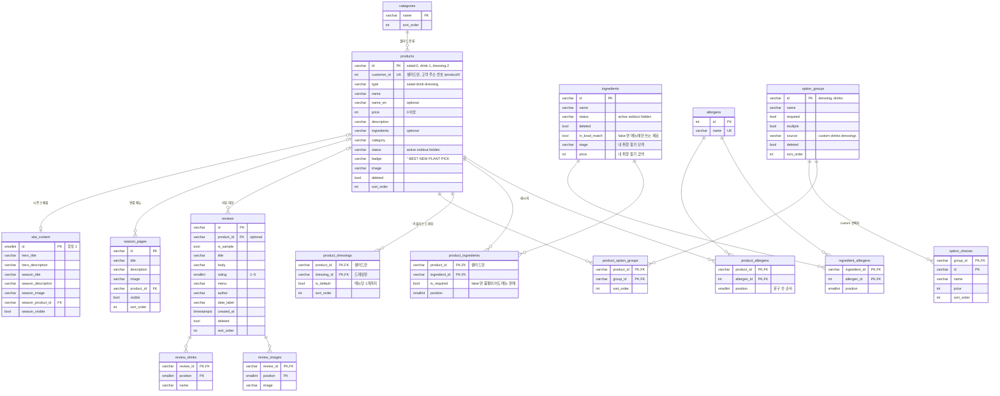
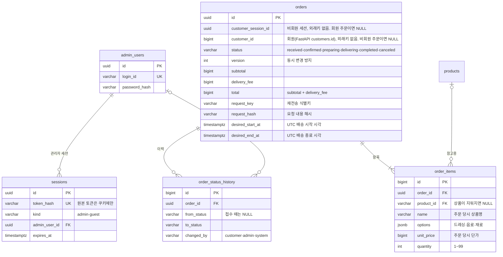

# leaf & bowl DB 설계

시간 처리: 모든 절대 시각은 UTC로 저장·응답하고 고객·관리자·미리보기 표시는 KST로 변환한다. 리뷰·매출·기존 기록 이관 규칙은 [시간 처리 규칙](time-policy.md)을 따른다.

PostgreSQL 18 · Prisma 7.10 · 기존 SQL 설계와 현재 앱 저장소 구현

## 목표

카탈로그·리뷰·주문·관리자 및 비회원 세션을 PostgreSQL에 저장한다.
기존 카탈로그 API 계약과 고객 상품 번호를 유지하고, 서버 재시작 이후에도 데이터와 세션을 보존한다.

기준: `modules/catalog/schema.ts` 의 `catalogSchema` (main, #23 반영). 알레르기는 연관 테이블과 원문 문구를 함께 저장하고 리뷰 via도 보존한다. 재료·재료 기준 자동 품절·메뉴별 드레싱은 아래 '재료와 재료 기준 자동 품절' 절에 추가.

## ERD



ERD 외에 1행짜리 테이블 2개가 더 있다: `catalog_meta` (저장 버전 revision), `store_location` (매장 위치).
재료(`ingredients`)와 관련 테이블은 아래 '재료와 재료 기준 자동 품절' 절에서 설명한다. 뷰 2개(`product_availability`, `bowl_match_ingredients`)도 그곳에 있다.

## 관리자 데이터 ↔ 테이블

| catalog.json | 테이블 |
| --- | --- |
| `revision`, `updatedAt` | catalog_meta |
| `location` | store_location |
| `categories[]` | categories (배열 순서 → sort_order) |
| `products[]` | products |
| `products[].optionIds[]` | product_option_groups |
| `groups[]` | option_groups |
| `groups[].choices[]` | option_choices |
| `products[].allergens` ("닭고기, 토마토") | allergens + product_allergens (쉼표로 나눠 저장, 읽을 때 position 순서로 다시 합침) |
| `ingredients[]` | ingredients, ingredient_allergens (+ 메뉴 전용 재료 13개를 추가) |
| `reviews[]` | reviews |
| `reviews[].images[]`, `reviews[].drinks[]` | review_images, review_drinks |
| `content` (seasonPages 제외) | site_content |
| `content.seasonPages[]` | season_pages |

이름 규칙: 코드의 camelCase 는 컬럼에서 snake_case (`detailAddress` → `detail_address`, `en` → `name_en`, `sample` → `is_sample`, `date` → `date_label`).
리뷰의 `via`(픽업·배달)는 기존 기록과 표시 호환성을 위해 저장한다.

## 설계 결정

| 결정 | 이유 |
| --- | --- |
| 관리자 카탈로그 구조를 그대로 따른다 | 화면·API 코드를 바꾸지 않고 저장소만 교체한다. 읽고 다시 쓰면 같은 JSON 이 나와야 한다 |
| 샐러드·음료·드레싱을 products 한 테이블, `type` 으로 구분 | 관리자 화면이 이미 한 목록으로 관리한다. 음료에도 BEST·NEW 뱃지가 있다 |
| 배열은 별도 테이블 + `sort_order`·`position` | 관리자가 정한 순서가 곧 화면 순서다 |
| id 는 문자열 그대로 (`salad-0`) | 관리자 화면이 id 를 만들고 옵션·시즌·리뷰가 그 id 로 서로를 가리킨다. 고객 주소용 숫자는 `customer_id` 로 따로 둔다 |
| 빈 문자열은 `''` 로 저장, optional 항목만 NULL | 관리자 데이터에서 `''`(비어 있음)와 "항목 없음"이 구분된다. 단 연결 id(`seasonProductId`, `productId`)의 `''` 는 외래키를 위해 NULL 로 바꿔 저장하고 읽을 때 `''` 로 되돌린다 |
| enum 대신 `VARCHAR + CHECK` | 값 목록이 zod 스키마와 같이 자주 바뀐다. CHECK 는 한 줄 수정으로 바뀌지만 ENUM 은 값 삭제가 어렵다 |
| 삭제는 `deleted` 플래그 | 관리자 화면이 삭제 후 복구를 지원한다. 리뷰·시즌이 가리키는 상품도 남아 있어야 한다 |
| 1행 테이블 (`id = 1` CHECK) | 매장 위치·메인 문구·저장 버전은 하나뿐이다 |
| 알레르기는 allergens + product_allergens 연관 테이블 (N:M) | 팀에서 연관 관계로 관리하기로 했다. "우유가 들어간 메뉴" 조회가 쉽고 같은 재료가 오타로 두 번 생기지 않는다(UNIQUE). 관리자 화면의 문구 입력은 그대로 두고 저장할 때 쉼표로 나눈다 |
| 정수 범위 체크 없음 (가격 0 이상·별점 1~5 만 유지) | 상한값(가격 100만 원, 사진 10장 등)은 zod 스키마가 이미 검사한다. DB 에는 값의 의미상 꼭 필요한 규칙만 둔다 |

## 재료와 재료 기준 자동 품절

요구: "연어가 품절이면 연어 샐러드는 자동으로 품절", "치킨이 품절이면 치킨이 든 여러 메뉴가 자동 품절", 같은 규칙을 **내 취향 찾기**에도 적용, 메뉴마다 **어울리는 드레싱**을 정한다.

### 추가한 것

| 이름 | 종류 | 역할 |
| --- | --- | --- |
| `ingredients` | 테이블 | 재료 31개: 내 취향 찾기 18 + **메뉴에만 쓰는 재료 13**(루콜라, 바질, 보리, 블랙빈, 스테이크, 양배추, 양파, 에다마메, 참치, 파르메산, 페타, 허브, 현미). `in_bowl_match` 로 구분한다 |
| `ingredient_allergens` | 테이블 | 재료별 알레르기 (상품과 같은 N:M) |
| `product_ingredients` | 테이블 | 메뉴 ↔ 재료(레시피). `is_required=false` 인 재료는 품절이어도 메뉴가 판매된다 |
| `product_dressings` | 테이블 | 메뉴 ↔ 어울리는 드레싱. `is_default` 는 메뉴당 1개까지 |
| `product_availability` | **뷰** | 메뉴의 실제 판매 상태와 품절 이유(재료 이름)를 **계산**해서 돌려준다 |
| `bowl_match_ingredients` | **뷰** | 내 취향 찾기 선택지. 품절 재료는 `available=false` 로 남긴다 |

### 판매 상태 계산 규칙

```
hidden   메뉴가 숨김 또는 삭제
soldout  메뉴가 품절이거나, 필수 재료 중 하나라도 품절·숨김·삭제
active   그 외
```

- **품절 여부를 메뉴에 저장하지 않는다.** 재료 상태에서 그때그때 계산하므로 "치킨은 품절인데 메뉴는 판매 중" 같은 어긋남이 생기지 않고, 재료를 복구하면 메뉴도 자동으로 돌아온다.
- 응답에 품절 이유(`soldout_ingredients`, 예: `["그릴 치킨"]`)를 같이 내려 화면에서 "치킨 품절로 주문이 어려워요"처럼 보여줄 수 있다.
- 내 취향 찾기에서는 품절 재료를 선택 불가로 두고, 추천에서는 `effective_status <> 'active'` 인 메뉴를 제외한다 (앱 규칙).

### DB 가 막아 주는 것

- `product_ingredients`·`product_dressings` 는 `product_type`·`dressing_type` 열이 항상 `'salad'`·`'dressing'` 으로 채워지고 `(id, type)` 외래키를 건다. 음료·드레싱 id 를 메뉴 자리에 넣거나 음료를 드레싱으로 연결하면 거부된다.
- 메뉴에 쓰이는 재료는 삭제할 수 없다 (`ON DELETE RESTRICT`). 삭제 대신 `deleted` 또는 품절로 처리한다.
- 내 취향 찾기 재료(`in_bowl_match`)는 단계·금액이 필수다. 메뉴 전용 재료는 없어도 된다.

### 검증 (PGlite, 실제 PostgreSQL)

`check_ingredients.mjs` 시나리오 30개 통과:

- 처음에는 샐러드 12개 모두 `active`
- 치킨 품절 → **레몬 치킨 아보카도·클래식 치킨 시저·스파이시 멕시칸 세트 3개가 자동 품절**, 이유 `["그릴 치킨"]`, 치킨 없는 메뉴는 그대로, 복구하면 자동 복구
- 연어 품절 → 연어 아보카도만, 메뉴 전용 재료(파르메산) 품절 → 스테이크 케일·클래식 치킨 시저만, 이때 내 취향 찾기 목록에는 변화 없음
- 선택 재료(`is_required=false`) 품절은 메뉴에 영향 없음, 메뉴를 직접 품절·숨김하거나 재료를 삭제한 경우도 규칙대로
- 잘못된 연결·중복 기본 드레싱·삭제 시도는 모두 거부

### 알아둘 점

- **메뉴 알레르기와 재료 알레르기 비교**: 재료에서 모은 알레르기와 지금 메뉴에 적힌 값이 12개 중 11개 같다. **클래식 치킨 시저**만 다르다 (메뉴에는 계란·생선이 있고 재료에는 없음. 시저 소스에 들어 있는 것으로 보이며 재료 목록에 소스가 없다). 그래서 메뉴 알레르기는 지금처럼 따로 저장하고, 재료는 대조용으로 쓴다.
- **샘플 데이터**: 메뉴 전용 재료 13개의 분류·알레르기(예: 보리→밀, 스테이크→쇠고기)와 메뉴별 드레싱(지금은 12개 메뉴에 드레싱 5개를 모두 허용)은 **예시 값**이다. 팀이 확정한 값으로 바꾼다.
- **세트에 포함된 음료**(오렌지 주스, 커피)는 재료가 아니라 음료 상품이라 연결하지 않았다. 음료 품절이 세트 품절로 이어져야 하는지는 정해야 한다.
- 관리자 데이터(`catalog.ts`)에 메뉴의 재료 목록(`ingredientIds`)과 드레싱 목록(`dressingIds`)이 있어야 이 표를 채울 수 있다 (관리자 화면 담당과 협의).

### 정해야 할 것

| # | 질문 | 이 문서의 가정 |
| --- | --- | --- |
| 1 | 메뉴 전용 재료 13개를 재료 테이블에 둔다 | 둔다. 내 취향 찾기에는 나오지 않는다 |
| 2 | 세트의 음료 품절이 세트 품절로 이어지나 | 이어지지 않는다 (미정) |
| 3 | 숨김·삭제 재료의 메뉴 | 품절과 똑같이 취급 |
| 4 | 선택 재료(토핑) 품절 | `is_required` 로 구분, 기본은 필수 |
| 5 | 메뉴별 드레싱 | 팀(매장 기준)이 확정. '드레싱 없이'는 항상 허용 |

## 주문과 인증

정민님 백엔드 설계안(PR #45)의 `Order`·`OrderItem`·`OrderStatusHistory`·`AdminUser`·`Session` 을 SQL 로 옮긴 것이다. 주문·인증 API는 PR #60에서 메모리 저장소로 구현되었으며, 아직 이 SQL의 DB 테이블에는 연결되지 않았다. 테이블 규칙이 설계대로 지켜지는지를 DB에서 먼저 확인했다.



### 설계안과 SQL 의 대응

| 설계안 | SQL |
| --- | --- |
| 주문 UUID, 상태, `version`, 주문자·연락처·주소·UTC 배송 시작/종료 시각, 상품 합계·배달비·총액 | `orders` 의 같은 이름 칸 (`total` 은 `subtotal + delivery_fee` 와 같아야 한다는 CHECK) |
| 고객 세션 ID 와 `requestKey` 복합 유일 | `UNIQUE (customer_session_id, request_key)` |
| 회원 주문 (0011, FastAPI UC-C) | 주인은 `customer_session_id`·`customer_id` 중 정확히 하나 (`CHECK num_nonnulls(...) = 1`). 회원은 `UNIQUE (customer_id, request_key) WHERE customer_id IS NOT NULL`, 목록은 `(customer_id, created_at DESC, id DESC)` 부분 인덱스. `customers` 는 FastAPI 가 만드는 표라 외래키를 걸지 않는다 |
| `requestHash` | `request_hash` (같은 키로 다른 내용을 보내면 서비스가 409) |
| 금액은 원 단위, 합계는 BigInt | `BIGINT`. JSON 응답에서는 십진 문자열로 변환 |
| 주문 항목은 주문 당시 값의 스냅샷 | `order_items.name·options·unit_price`. `product_id` 는 참고용(상품이 지워지면 NULL) |
| 상태 변경 이력 | `order_status_history` |
| `(status, createdAt, id)` 검색용 인덱스와 마지막 주문 기준 다음 쪽 | `idx_orders_list (status, created_at DESC, id DESC)` |
| 관리자·비회원 구분 세션, 토큰 해시 | `sessions.kind`, `token_hash` |
| 비밀번호 해시 | `admin_users.password_hash` |
| 카탈로그 버전 행을 읽기·쓰기 잠금 | 기존 `catalog_meta` 행을 `FOR SHARE`(주문)·`FOR UPDATE`(관리자 저장)로 잠근다 |

### DB 가 한 번 더 막아 주는 것

- 상태 순서: `received → confirmed → preparing → delivering → completed`, 취소는 `received`·`confirmed` 에서만, 완료·취소는 더 바꿀 수 없다 (트리거). 서비스 코드가 실수해도 잘못된 상태가 저장되지 않는다.
- 취소 상태와 취소 시각은 함께 있어야 한다. 합계가 맞지 않으면 저장되지 않는다.
- 관리자 세션에는 관리자 계정이, 비회원 세션에는 없어야 한다.
- 수량은 1~99, 단가는 0 이상이다.
- 주문을 지우면 항목·이력이 함께 정리되고, 관리자 계정을 지우면 그 세션도 정리된다.

### 서비스가 맡는 것 (DB 만으로 안 되는 것)

- 같은 키로 다시 보내면: 같은 내용(`request_hash` 가 같음)이면 기존 주문을 반환, 다르면 409. 키 중복(`23505`/Prisma `P2002`)은 트랜잭션을 취소하고 기존 주문을 다시 읽어 처리한다.
- 상태 변경: `UPDATE ... WHERE id = ? AND version = ? AND status = ?` 로 바꾸고 변경 건수가 0 이면 409. 성공하면 `version + 1` 과 이력을 같은 트랜잭션에 저장한다.
- 가격 계산은 서버가 카탈로그에서 다시 한다 (화면이 보낸 가격을 믿지 않는다).
- 비밀번호 해시 계산, 세션 쿠키 설정, 요청 제한.

### 검증 (PGlite, 실제 PostgreSQL)

`check_orders.mjs` 시나리오 37개 통과: 주문 접수(주문·항목·이력 한 트랜잭션), 같은 키 재전송 중복 거부와 다른 세션 분리, 두 관리자가 같은 `version` 으로 바꿀 때 한 명만 성공, 허용되지 않는 상태 변경 거부, 취소 규칙, 상품 가격·이름이 바뀌거나 상품이 지워져도 주문 항목 유지, 항목 규칙, 세션 규칙, 관리자 목록의 다음 쪽 조회.

**한계**: 시험이 연결 1개라 "진짜 동시에 두 명"은 재현하지 못한다. `version` 조건이 0 건이 되어 덮어쓰기를 막는 논리까지만 확인했고, **읽기·쓰기 잠금(`FOR SHARE`/`FOR UPDATE`)은 실제 PostgreSQL 서버에서 따로 확인해야 한다.**

### 세션 정리와 상한

- 만료된 세션은 해당 토큰으로 다시 접근할 때만 지워지면 계속 쌓이므로, 세션을 발급할 때 1분에 한 번 `purgeExpired(now)` 로 쓸어낸다. DB 에서는 `DELETE FROM sessions WHERE expires_at <= $1` 이고 `idx_sessions_expires` 를 쓴다.
- 비회원 세션은 동시에 유효한 개수에 상한(10,000)을 둔다. 상한에 이르면 새 세션 발급은 503, 이미 가진 세션은 계속 쓸 수 있다. **개수 확인과 저장은 한 번에(원자적으로) 해야 한다**: 먼저 세고 따로 저장하면 동시 요청이 모두 통과해 상한을 넘는다(상한 3에 동시 20건이 모두 성공하는 것을 재현했다). 저장소 계약의 `createSessionWithinLimit` 이 이를 맡고, DB 에서는 한 문장 `INSERT ... SELECT ... WHERE (SELECT count(*) FROM sessions WHERE kind = 'guest' AND expires_at > $1) < $2` 를 `pg_advisory_xact_lock` 아래에서 실행한다(READ COMMITTED 에서는 잠금 없이는 동시 삽입이 서로를 보지 못한다).
- 로그인 시도 제한은 **계정이 존재하는지와 무관한** 키(아이디를 1,024칸으로 해시)를 쓴다. 존재 여부로 칸을 나누면 모르는 아이디와 실제 계정의 응답(429/401)이 달라져 계정 존재 여부가 드러난다. 비밀번호 검사의 CPU 총량은 전체 한도(분당 120)로 따로 제한한다.
- **제한 사항 (알고 선택한 트레이드오프)**
  - **아이디별 독립 카운터가 아니다.** 아이디는 1,024칸을 공유하고 칸 안에서 카운터를 같이 쓴다. 기본 한도는 칸당 분당 10회다.
  - **충돌하는 아이디로 관리자 로그인을 1분간 막을 수 있다.** 예: 존재하지 않는 `collision-687` 은 `admin` 과 같은 `account:741` 칸이다. `collision-687` 로 틀린 시도 10회(401) 뒤에는 올바른 `admin` 비밀번호도 429 이고, 60초가 지나면 다시 200 이다(`tests/session-abuse.test.cjs`). 이는 `admin` 을 직접 10회 틀려 잠그는 것과 같은 효과라 공격자의 능력이 늘지는 않지만, `admin` 이라는 아이디를 보내지 않고도 가능하다. 해시가 비밀값 없는 SHA-256 이라 충돌 아이디는 약 1,024회 계산으로 찾을 수 있다. "임의의 아이디 공격이 관리자 로그인을 막지 않는다"는 말은 무작위 아이디(테스트의 `ghost-0`~`ghost-299` 300개 샘플)에서만 관찰된 것이며 일반 보장이 아니다.
  - **전체 한도(분당 120)는 전체 로그인을 잠글 수 있다.** 누구나 1분에 요청 120개를 보내면 관리자를 포함한 모든 로그인이 그 구간 동안 429 이다. CPU 보호(비밀번호 검사 총량 제한)를 가용성보다 우선한 선택이다. 세션 발급 전체 한도(분당 120)도 같은 방식으로 새 방문자의 발급을 막을 수 있다.
  - 요청자별 제한은 신뢰할 프록시(`TRUSTED_PROXY_HOPS`) 확인 후에 보완할 수 있다. 요청 제한 카운터는 서버 재시작 시 초기화되고 서버 간 공유되지 않는다. 주문·세션은 DB에 보존된다.
- 요청 제한기(로그인·세션·주문)는 서버 메모리의 임시 장치다. 서버가 여러 대가 되면 DB 나 Redis 로 옮겨야 한다.

### 구현된 저장소 트랜잭션 계약

`modules/orders/repository.ts`의 `transaction(work, catalogForTests)`는 기존 요청 조회, 잠금 아래 카탈로그 조회, 주문·항목·초기 이력 생성을 하나로 묶는다. PostgreSQL 어댑터는 `OrdersTransaction.getCatalog()`에서 `catalog_meta`를 `FOR SHARE`로 잠그며 관리자 저장은 `FOR UPDATE`를 사용한다. 테스트용 메모리 어댑터만 `catalogForTests`를 사용한다.

키 중복 P2002는 `DuplicateRequestError`로 변환한 뒤 트랜잭션을 취소한다. 서비스는 콜백 밖에서 승자의 주문을 다시 읽어 요청 해시를 비교한다. 상태 변경은 저장소의 `updateStatus`가 자체 트랜잭션에서 조건부 갱신과 이력을 함께 기록한다. P2034 충돌만 최대 3회 재시도하며 업로드·외부 API 호출은 이 콜백 안에서 수행하지 않는다.

### 적용된 Prisma 모델과 마이그레이션

Prisma CLI·Client·PostgreSQL adapter는 7.10.0이다. 전체 카탈로그·주문·인증 모델을 `prisma/schema.prisma`에 정의했고 `@@map`·`@map`으로 기존 테이블·열 이름을 유지한다. `infrastructure/database/prisma.ts`는 연결 풀(프로세스당 최대 5개)을 재사용한다. 생성 코드 `generated/prisma`는 `npm ci`의 postinstall에서 생성하고 Git에서 제외한다.

| 마이그레이션 | 내용 |
| --- | --- |
| `0001_baseline` | 기존 `db/schema.sql`의 테이블, IDENTITY, CHECK, 부분 인덱스, 생성 열, 뷰, 상태 전이 트리거를 그대로 생성 |
| `0002_catalog_persistence` | 다음 고객 상품 번호, 리뷰 삭제 이력·via, 원산지, 원문 알레르기, 시즌 페이지 유무, 주문 항목 순서·종류 |
| `0003_allergen_text` | 알레르기 문구 길이 호환, 상품 삭제 후에도 주문 상품 식별자를 보존하는 스냅샷 열 |
| `0004_app_settings` | 배너·배송시간·가격 정책·영양정보·옵션 열량·재료 이모지의 JSONB 설정 |

Prisma가 표현하지 못하는 DB 규칙은 migration SQL에서 유지한다. 생성 열은 `dbgenerated()`로 표시해 INSERT 시 직접 값을 보내지 않는다. `prisma db push`나 스키마에서 자동 생성한 DDL로 baseline SQL을 대체하지 않는다.

### 저장 방식

카탈로그 읽기는 공유 잠금 아래 모든 테이블을 읽어 하나의 스냅샷으로 조립한다. 전체 저장·리뷰 추가는 배타 잠금 아래 revision·리뷰 중복/삭제 이력을 확인하고 원자적으로 반영한다. 새 상품 번호는 `next_customer_id`로 계속 증가하며 영구 제거된 리뷰는 `deleted_review_ids`에서 보존한다. 선택 배열이 없는 경우와 빈 시즌 페이지 배열도 구분한다. 연결 실패를 JSON 파일이나 메모리 저장으로 대체하지 않는다.

관리자·고객 화면, 개별 상품 API, 주문 가격 계산은 같은 카탈로그를 사용한다. 주문 항목에는 이름·단가·옵션·상품 식별자를 스냅샷으로 보존한다. 판매 현황은 DB의 완료 주문만 집계하며 완료 시각을 사용한다. 결제 확정이나 실제 청구를 의미하지 않는다. 기존 가상 판매 JSON은 실제 매출로 가져오지 않는다.

고객 주문 화면은 비회원 쿠키 세션을 발급받고 `/api/v1/orders`에 접수한다. 마이페이지는 같은 세션으로 DB 주문을 조회하며 과거 브라우저의 체험 기록도 별도로 보존한다. 관리자 세션·비밀번호 해시는 DB에 저장한다. 비회원 세션의 개수 확인·발급은 종류별 advisory lock 아래 실행한다. 요청 제한 카운터는 프로세스 메모리이며 다중 인스턴스 전체 제한이 필요하면 별도 공유 제한기가 필요하다.

### 이번에 넣지 않은 것

- 회원 계정·소셜 인증: 고객 프로필·배송지·취향은 기존 브라우저 체험 저장을 유지한다.
- 실제 결제(PG), 주문 알림, 매장 관리.
- 레시피 관계를 편집하는 관리자 UI와 재료 자동 품절 UI: 기존 SQL 관계·뷰는 보존하며 이 화면 기능은 별도 작업이다.

## 실행과 이관

실제 실행, 기존 JSON 백업·가져오기, 계정 설정, 테스트 DB와 배포 환경은 [PostgreSQL 운영 가이드](postgres.md)를 따른다. 새 DB에는 `npm run db:migrate`를 사용한다. 현재 앱 초기값은 `npm run db:seed`로 넣으며 기존 JSON을 가져올 때는 seed보다 먼저 `db:import`를 실행한다. `db/seed.sql`은 실제 기본 데이터의 실행 원본이며 `db:seed`와 직접 SQL 실행이 같은 데이터를 넣는다. `db/schema.sql`은 현재 전체 구조를 새 DB에 직접 생성하는 SQL이다. 기존 DB에는 버전별 migration을 사용한다.

`app_settings`는 `key`, `value JSONB`, `updated_at`으로 구성한다. 기본 키는 `hero_slides`, `delivery_hours`, `pricing_policy`, `nutrition`, `option_kcal`, `ingredient_emojis`다. 고객 카탈로그는 검증한 DB 설정을 함께 전달한다. 주문 생성은 가격 정책 행을 `FOR SHARE`로 잠근 상태에서 금액을 계산하며, 설정이 없거나 잘못되면 주문을 저장하지 않는다. 설정을 직접 수정할 때는 `updated_at`도 갱신한다.
