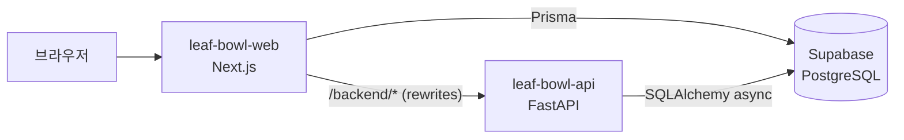

# Vercel 배포 기록 (도전 C-2)

leaf & bowl 2.0 을 Vercel 프로젝트 두 개로 배포했다. 화면(Next.js)이 `/backend/*` 요청을 FastAPI 로 넘기고, 둘 다 같은 Supabase PostgreSQL 을 쓴다.

## 배포 주소

| 구분 | 주소 | Vercel 프로젝트 | 올리는 폴더 |
| --- | --- | --- | --- |
| 화면 (Next.js) | https://leaf-bowl-web.vercel.app | `leaf-bowl-web` | 레포 루트 (`backend/` 제외) |
| 서버 (FastAPI) | https://leaf-bowl-api.vercel.app | `leaf-bowl-api` | `backend/` |
| API 문서 | https://leaf-bowl-api.vercel.app/docs | | |



- 두 프로젝트 모두 서울 리전(`icn1`)에서 실행한다. DB 도 서울이라 왕복이 짧다.
- 브라우저는 화면 주소만 부른다. API 는 같은 도메인의 `/backend/*` 로 넘어가므로 CORS 설정이 필요 없다.

## 환경 구성표

값은 Vercel 프로젝트 환경 변수(Production)에만 넣는다. 레포·문서·채팅에는 적지 않는다.

| 프로젝트 | 이름 | 종류 | 설명 |
| --- | --- | --- | --- |
| leaf-bowl-api | `DATABASE_URL` | Secret | Supabase **Transaction pooler(6543)** 주소 |
| leaf-bowl-api | `DATABASE_DISABLE_STATEMENT_CACHE` | 일반 | `true` (Transaction pooler 는 prepared statement 를 못 씀) |
| leaf-bowl-api | `DATABASE_POOL_SIZE` / `DATABASE_MAX_OVERFLOW` | 일반 | `1` / `2` (함수 인스턴스마다 DB 연결을 적게) |
| leaf-bowl-api | `JWT_SECRET_KEY` | Secret | 토큰 서명 키 |
| leaf-bowl-web | `DATABASE_URL` | Secret | Supabase Transaction pooler(6543) 주소 (Prisma) |
| leaf-bowl-web | `BACKEND_URL` | 일반 | `https://leaf-bowl-api.vercel.app` (빌드 때 rewrites 에 들어감) |

로컬 실행과 달라지는 점

| 항목 | 로컬 | Vercel |
| --- | --- | --- |
| FastAPI 실행 | `uvicorn main:app --app-dir src` | `backend/index.py` 가 `src` 를 import 경로에 넣고 `main.app` 을 내보냄 |
| DB 주소 | Session pooler(5432) | Transaction pooler(6543) |
| 비밀값 | `backend/.env`, `.env.local` | Vercel 환경 변수 (`.vercelignore` 로 `.env*` 업로드 차단) |

## 배포 방법

```bash
npx vercel login                      # 계정 연결 (최초 1회)
cd backend && npx vercel deploy --prod   # 서버
cd .. && npx vercel deploy --prod        # 화면 (BACKEND_URL 이 먼저 있어야 함)
```

배포 설정 파일: `vercel.json`(`framework: nextjs`), `backend/vercel.json`(`framework: fastapi`), 각 폴더의 `.vercelignore`.

## 실행 확인 기록 (2026-10-27, 배포 주소 기준)

| # | 확인 | 결과 |
| --- | --- | --- |
| 1 | `/`, `/menu`, `/login`, `/mypage` 화면 | 200 |
| 2 | `/backend/health/db` (화면 → 서버 → DB) | 200 `{"status":"ok"}` |
| 3 | `/api/catalog` (화면 → DB, Prisma) | 200 |
| 4 | 메뉴 검색 `/backend/api/v1/menus` | 200, 메뉴 목록 |
| 5 | 회원가입 → 틀린 비밀번호 → 로그인 | 201 → 401 → 200 + 토큰 |
| 6 | 내 정보 수정 `PATCH /api/me` | 전화번호 저장 |
| 7 | 배송지 추가 | 201, 첫 배송지 자동 기본 |
| 8 | 로그인 기록 (BackgroundTasks) | 성공·실패(wrong_password) 2건 저장 — Vercel 에서도 응답 뒤 기록됨 |
| 9 | 로그인 기록 CSV | 200 `text/csv`, `Transfer-Encoding: chunked` (스트리밍) |
| 10 | 토큰 없이 `/api/me` | 401 `unauthorized` "로그인이 필요합니다." |
| 11 | 로그아웃 → 같은 토큰 재사용 | 204 → 401 "로그아웃된 토큰입니다." |

주문 → 관리자 상태 변경 → 회원 화면 반영 → 영수증 흐름은 같은 DB·같은 코드로 로컬 통합 점검(2026-10-27 오전)에서 확인했다. 확인용 테스트 계정·데이터는 모두 삭제했다.

## 문제 해결 기록

| 문제 | 원인 | 해결 |
| --- | --- | --- |
| 배포는 성공인데 모든 주소가 Vercel 404 | CLI 로 만든 프로젝트라 프레임워크가 지정되지 않아 빌드가 0.1초 만에 빈 결과로 끝남 | `vercel.json` 에 `framework`(`fastapi`, `nextjs`) 지정 |
| FastAPI 를 못 찾음 | 앱이 `backend/src/main.py` 에 있고 모듈끼리 `from auth ...` 로 불러옴 | `backend/index.py` 입구 추가 |
| 화면 500, `EMAXCONNSESSION max clients ... pool_size: 15` | Session pooler(5432)는 동시 15개 제한. 팀원 로컬 서버와 서버리스 함수가 자리를 나눠 씀 | 두 프로젝트 모두 Transaction pooler(6543) + statement cache 끄기 + 풀 크기 축소 |
| 함수가 미국에서 실행됨 | 기본 리전 `iad1` | `regions: ["icn1"]` |

## 알려진 제한

- 비회원 결제(토스 테스트 키)는 환경 변수를 넣지 않아 배포본에서는 사용하지 않는다. 회원 주문은 결제 없이 접수된다.
- Vercel 함수의 파일 시스템은 배포마다 초기화되므로, 관리자 이미지 업로드 파일은 배포본에 오래 남지 않는다.
- 미리보기(Preview) 배포는 Vercel 로그인 보호가 걸려 있다. 공개 주소는 위 Production 주소를 쓴다.
