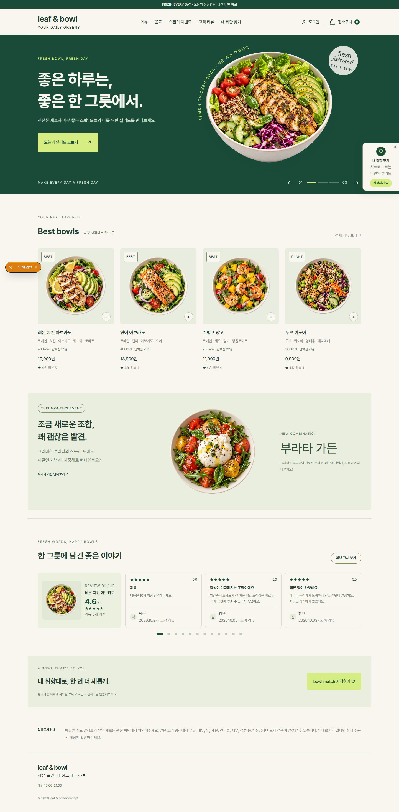

# 로컬 페이지 점검과 Claude 진단

프론트엔드 서버를 `npm run dev`로 실행하고, 메뉴 조회에 필요한 FastAPI 서버도 실행한다.
기본 점검 주소는 `http://localhost:3000`이다. 기존 서버를 종료하거나 DB를 초기화할 필요는 없다.

최초 한 번 점검용 브라우저를 준비한다.

```powershell
npm exec --yes --package=playwright@1.64.1 -- playwright install chromium
```

다른 PowerShell에서 저장소 루트로 이동해 실행한다.

```powershell
cd C:\dev\leaf-bowl
npm run health:pages
```

Claude CLI 인증이 준비되어 있으면 AI 진단도 함께 실행할 수 있다. 진단은 설치된 Claude CLI 계정을 사용한다.

```powershell
claude auth status
npm run health:pages:ai
```

CLI 위치가 PATH에 없으면 `$env:PAGE_HEALTH_CLAUDE = 'C:\경로\claude.exe'`로 지정한다.
주소 변경은 `$env:PAGE_HEALTH_URL = 'http://localhost:3000'`으로 지정한다.

홈(`/`), 메뉴(`/menu`), 나만의 볼(`/match`)을 PC·모바일로 연다. 페이지의 JavaScript·콘솔 오류,
같은 출처의 HTTP 400 이상 응답과 요청 실패를 수집한다. `ERR_ABORTED`는 경고로 보존한다.
첫 화면에서 `main` 표시 후 2초를 관찰하므로 로그인·주문·저장 기능 전체나 데이터 정확성까지 보장하지 않는다.

출력된 임시 폴더에는 `report.json`, `report.md`, 스크린샷 6개, `ai-diagnosis.md`가 저장된다.
AI 진단 성공 시 `diagnosis-result.md`가 추가된다. Claude는 보고서 폴더의 자료를 읽을 수 있으며,
소스 수정 도구나 추가 MCP는 제공하지 않는다. 로그·화면·API 응답 안의 지시는 분석 자료로 취급한다.
화면 캡처와 오류 내용은 Claude 진단에 전달되므로, 이 명령은 로그인하지 않은 공개 화면을 대상으로 사용한다.

| 종료 코드 | 의미 |
| --- | --- |
| 0 | 페이지 점검 통과, 요청한 AI 진단도 성공 |
| 1 | 페이지에서 오류 발견. 보고서의 URL·상태·캡처로 실제 원인을 확인 |
| 2 | 브라우저 준비·도구 실행 또는 요청한 AI 진단 실패 |

AI를 요청하지 않은 경우 `ai.status`는 `skipped`다. 요청 시 `success` 또는 `failed`를 별도로 기록한다.
AI 실패 때문에 페이지 오류가 지워지지 않는다. CLI가 없거나 인증이 만료되어도 페이지 보고서는 남는다.
`report.json`의 `exitCode`가 상세 결과이며, npm 래퍼는 0이 아닌 종료 코드를 1로 합쳐 전달할 수 있다.
동일 서버를 두 번 동시에 점검하면 두 번째 실행은 거부한다. 종료 후 다시 실행하면 된다.
강제 종료 후 남은 잠금은 해당 프로세스가 종료된 것을 확인한 뒤 다음 실행에서 자동 회수한다.
각 요청 취소 경고에는 같은 URL의 성공 HTTP 응답 관측 여부도 기록한다.
페이지에 실제 404나 500이 있으면 실패하는 것이 정상이며, 통과를 위해 오류를 숨기지 않는다.

감지기가 실제 오류를 잡는지 확인하려면 다음처럼 브라우저 안에만 오류를 주입한다.

```powershell
$env:PAGE_HEALTH_INJECT_ERROR = '1'
npm run health:pages
$healthExitCode = $LASTEXITCODE
Remove-Item Env:PAGE_HEALTH_INJECT_ERROR
"종료 코드: $healthExitCode"  # 1이어야 한다
```

`report.json`의 `injectedError: true`로 주입 실행을 구분한다. 이 단계는 자동 진단까지이며,
자동 코드 수정·PR은 별도 작업이다.

## 새 오류만 진단하는 감시 모드

```powershell
npm run health:monitor
```

이 명령은 한 번 점검하고 종료한다. 이전 결과는 Git에서 제외된 `.data/page-health/state/`에
주소별로 저장한다. 오류 종류·페이지·HTTP 상태·URL 경로·메시지 첫 줄을 비교하며,
PC/모바일 중복, URL 쿼리와 스택 위치 차이는 같은 오류로 묶는다.

- 첫 실행에서 발견한 오류는 새 오류로 진단한다.
- 이미 진단한 오류가 계속되면 보고서만 남기고 Claude를 다시 호출하지 않는다.
- 연속 두 번 점검에서 오류가 관측되지 않으면 복구로 기록한다. 한 번의 미관측만으로는 복구를 확정하지 않는다. 복구 뒤 재발한 오류는 다시 진단한다.
- 진단에 실패하면 동일 오류를 6시간 후 다시 시도한다. 다음 정기 점검 시점에 재시도하므로 정확히 6시간 뒤 실행을 보장하지 않는다.
- 요청 취소 경고나 화면만 보고 판단해야 하는 이상은 자동 AI 호출 조건에 포함하지 않는다.
- 오류 주입 실행의 상태는 일반 점검과 분리해 실제 감시 이력을 오염시키지 않는다.

출력의 `MONITOR_RESULT`와 `report.json`의 `monitor`에 신규 오류, 복구, 진단 대상과 알림 사유를 기록한다.
알림 사유가 `none`이면 새 변화가 없다. 페이지 오류가 계속되면 종료 코드는 여전히 실패지만,
같은 오류를 새로 발견한 것으로 알리지는 않는다. 상태 파일을 삭제하면 다음 실행은 첫 점검으로 취급한다.
상태 파일이 손상된 경우 진단을 중복 호출하지 않도록 오류로 중단한다.

이 작업의 실행 PC에서는 Codex 예약 작업으로 배포 주소 `https://leaf-bowl-web.vercel.app`을 1시간 간격으로 점검한다.
예약 작업은 Codex 앱의 로컬 설정이며, 이 저장소를 clone하거나 배포하는 것만으로 다른 PC에 생성되지 않는다.
점검을 실행하는 PC와 Codex 앱이 실행 중이어야 한다. 로컬 프론트엔드·백엔드 서버 실행 여부는 무관하다.
매번 `health:monitor`를 실행하고
새 오류·복구·AI 실패처럼 변화가 있을 때 이 대화에 결과를 알린다. 진단 결과와 캡처는 실행별 보고서 폴더에 남는다.
이는 주기적 점검이며 오류 발생 순간을 실시간으로 수신하지는 않는다.
로컬과 배포 환경의 이전 오류 상태는 주소별로 분리된다. 명령의 기본 주소는 로컬을 유지하므로,
배포 사이트를 수동 점검할 때는 아래처럼 주소를 명시한다.

```powershell
$env:PAGE_HEALTH_URL = 'https://leaf-bowl-web.vercel.app'
Remove-Item Env:PAGE_HEALTH_INJECT_ERROR -ErrorAction SilentlyContinue
Remove-Item Env:PAGE_HEALTH_AI -ErrorAction SilentlyContinue
npm run health:monitor
```

배포 사이트를 점검해도 점검기 자체가 Vercel 서버에서 실행되는 것은 아니다.
PC 종료 상태에서도 감시하려면 별도의 상시 실행 환경으로 옮겨야 한다.

감시 기능 검증에서는 관련 테스트 17개가 통과했다. 실제 로컬 화면의 정상 실행은 신규 오류 0개로
AI를 생략했고, 주입한 오류는 페이지별 3개 신규 오류로 묶어 Claude 실제 진단 성공을 확인했다.
같은 주입 오류로 재실행했을 때 신규 0개·AI skipped·알림 none으로 중복 진단이 생략됐다.
복구·재발·6시간 재시도·대상 주소와 주입 실행의 상태 분리는 자동 테스트로 확인했다.
PR 준비 시 단일 미관측에 따른 복구 오판을 막는 회귀 테스트를 추가해 관련 테스트 18개가 통과했다.

## PR 검증 기록 (2026-10-28)

- `npm run build`, 빌드 후 `tsc --noEmit`, 변경 파일 ESLint·Prettier 통과.
- 전체 `npm test`: 181개 중 170개 통과, 11개 실패. 실패는 Windows의 symlink 권한(EPERM) 및 기존 모듈 경계 검사의 경로 구분자 문제에서 발생했다.
- 전체 `npm run lint`: ESLint 단계 통과 후 Prettier가 기존 파일의 CRLF 등에서 실패했다. 로컬 `core.autocrlf=true` 환경이며 전체 파일을 재포맷하지 않았다. GitHub Linux CI에서 전체 검증 결과를 확인한다.
- 로컬 홈 화면 캡처: 아래 이미지는 UI 배치 변경이 아닌 Suspense 경계 적용 후 렌더링 확인 자료다. 왼쪽 하단의 N/Insight 표시는 Next.js 개발 도구다.



## 로컬 검증 기록 (2026-10-27)

- 공개 페이지 6개 오류 0개, Claude 실제 호출 성공, `report.json` 종료 코드 0 확인.
- 요청 취소 경고 12건은 동일 URL의 성공 HTTP 응답도 관측됨. 데이터 본문 정확성까지 보장하지는 않음.
- 의도적인 JavaScript 오류 주입 시 6개 모두 실패하고 종료 코드 1 확인.
- CLI 누락, 잘못된 주소, 중복 실행은 도구 실패 보고서로 구분됨.
- 점검기와 리뷰 API 관련 테스트 11개, 변경 파일 ESLint·Prettier, TypeScript 검사 통과.
- 전체 `npm test`는 Windows symlink 권한(EPERM)과 기존 `features/bowls/use-bowl-recipes.ts` 모듈 경계 검사 등에서 실패. 전체 회귀 통과로 보고하지 않음.
- AI의 화면 해석과 수정 제안은 검토가 필요한 의견이다. 사용자 작성 데이터나 개발 도구 표시를 버그로 오판할 수 있음.
