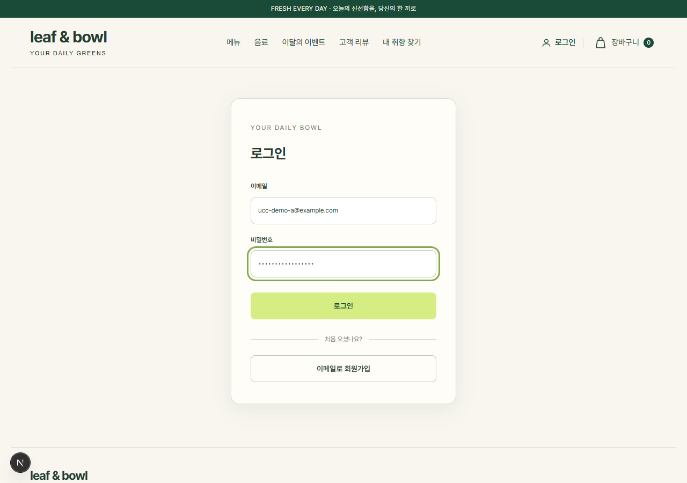
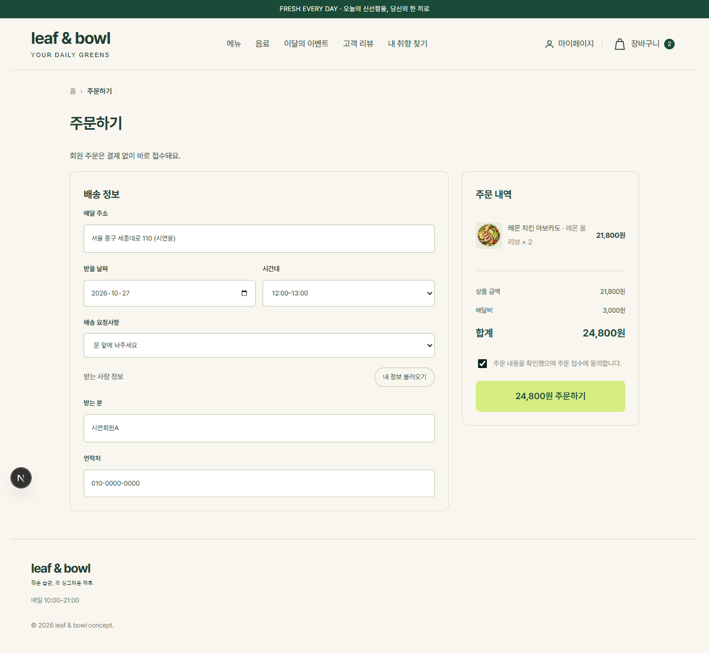
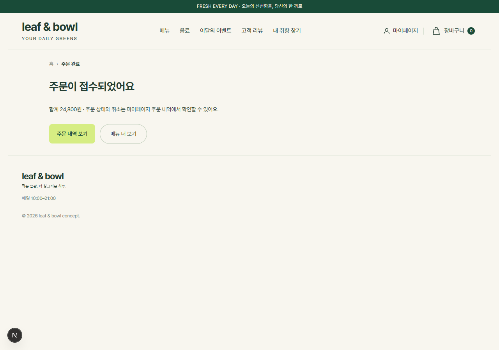
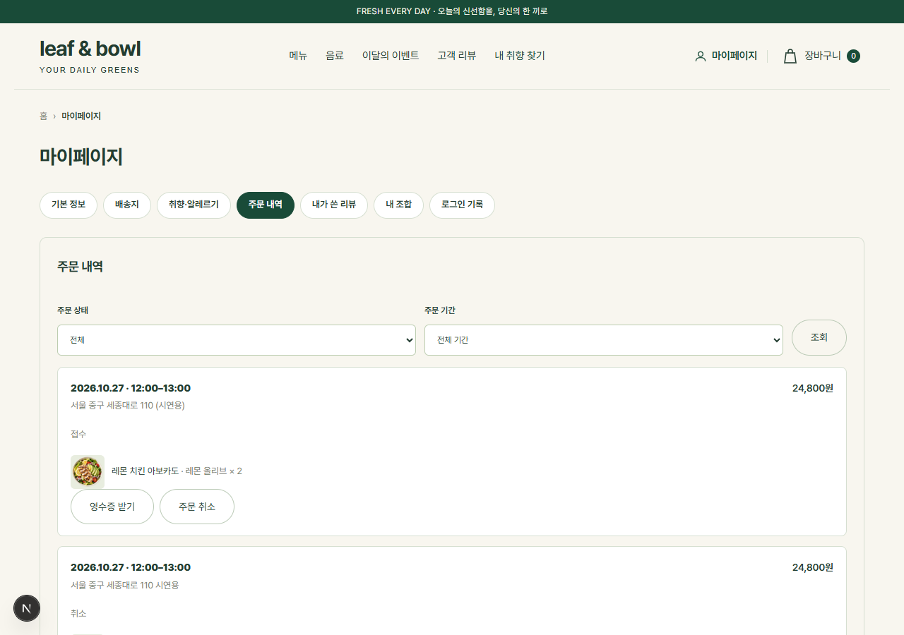
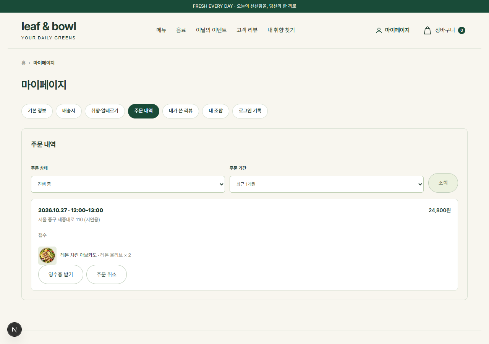
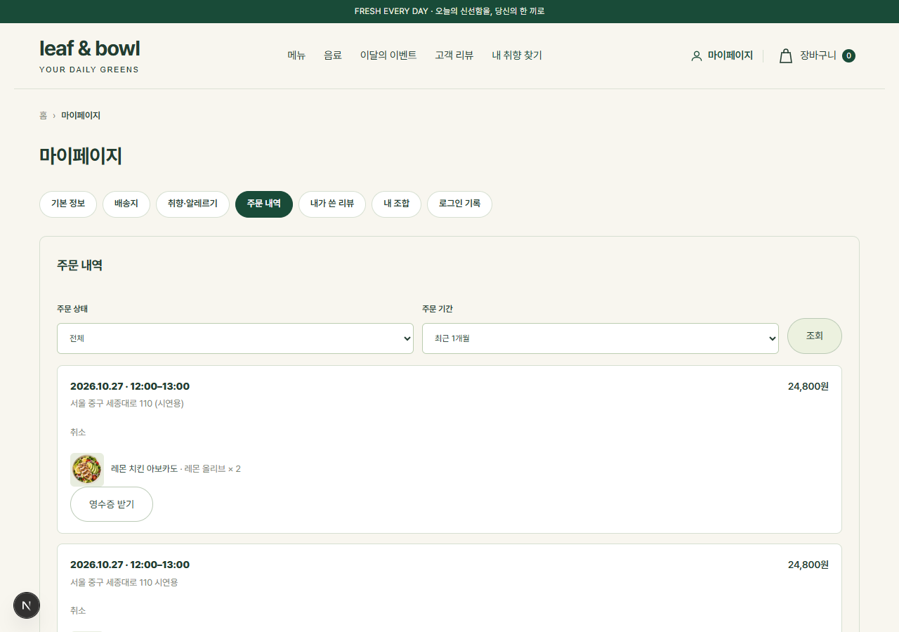
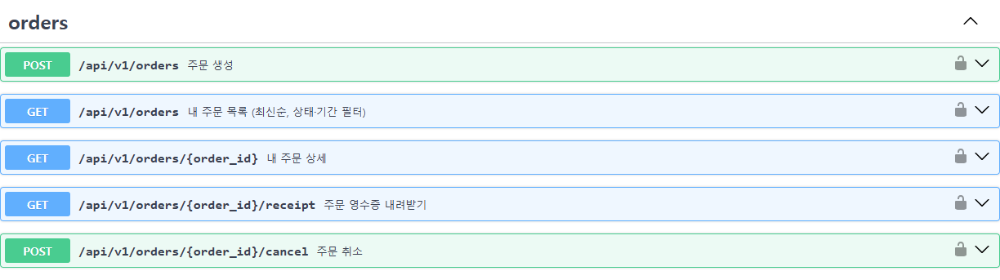
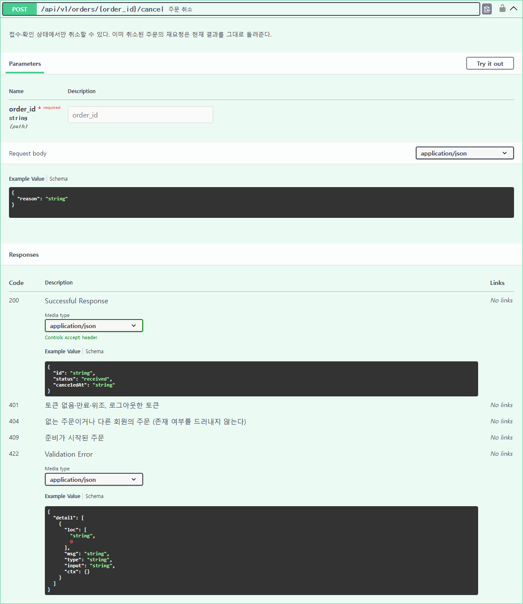

# UC-C 회원 주문 — 실행 기록

담당: C · 화면 → API → 업무 규칙 → DB 로 이어지는 **회원 주문 생성 · 내 주문 목록(필터·페이지) · 취소 · 영수증**을 실제로 실행한 결과입니다.

| 항목 | 내용 |
| --- | --- |
| 실행일 | 2026-10-26 (KST) |
| 서버 | 로컬 FastAPI(`uv run uvicorn main:app --app-dir src`, :8000) + Next.js 개발 서버(:3000) |
| DB | 팀 공용 PostgreSQL(Supabase). 아래 기록의 주문은 실제로 저장되었다 |
| 계정 | 시연 전용 계정 `ucc-demo-a@example.com`, `ucc-demo-b@example.com` (가데이터). 비밀번호·토큰은 기록하지 않는다 |
| 코드 | `backend/src/orders/` (4계층), `features/member/client.ts`, `components/mypage/OrdersTab.tsx`, `components/CheckoutView.tsx` |

구조와 요청 흐름은 [4계층 역할](architecture/3-layers.png), [주문 생성 흐름](architecture/5-order-flow.png), [로그인 흐름](architecture/4-login-flow.png) 그림을 참고합니다.

## 1. 화면에서 실행 (화면 → API → DB → 화면)

화면을 자동 조작(Chromium)해 실제 로그인부터 영수증까지 진행했다. 화면이 보낸 요청과 응답 코드는 아래와 같다.

```text
POST 201 /api/v1/orders                                   ← 주문하기
GET  200 /api/v1/orders?limit=20                          ← 마이페이지 주문 내역
GET  200 /api/v1/orders?limit=20&status=received&status=confirmed&status=preparing&status=delivering&from=2026-09-26&to=2026-10-26
POST 200 /api/v1/orders/6524cec0-…/cancel                 ← 주문 취소
GET  200 /api/v1/orders?limit=20&from=2026-09-26&to=2026-10-26
GET  200 /api/v1/orders/6524cec0-…/receipt                ← 영수증 받기
```

| ① 로그인 (FastAPI JWT) | ② 주문하기 — 서버가 다시 계산한 금액 |
| --- | --- |
|  |  |
| **③ 주문 접수 (201)** | **④ 마이페이지 주문 내역** |
|  |  |
| **⑤ 필터: 진행 중 · 최근 1개월** | **⑥ 취소 후 — 상태 "취소", 취소 버튼 사라짐** |
|  |  |

⑦ "영수증 받기"로 저장된 파일 (`leafbowl-receipt-6524cec0.txt`, StreamingResponse):

```text
leaf & bowl 주문 영수증
========================================
주문번호: 6524cec0-4ee4-40cf-ab86-c6c7a2e65be5
주문일시: 2026-10-26 15:59 (KST)
주문상태: 취소
결제상태: 결제 취소
취소일시: 2026-10-26 15:59 (KST)
----------------------------------------
받는 분: 시연회원A
배달 주소: 서울 중구 세종대로 110 (시연용)
배달 시간: 2026-10-27 12:00–13:00
----------------------------------------
레몬 치킨 아보카도 × 2
  선택: 레몬 올리브
  10,900원 × 2 = 21,800원
----------------------------------------
상품 금액: 21,800원
배달비: 3,000원
취소 금액: 24,800원
========================================
발행일시: 2026-10-26 15:59 (KST)
주문 확인용 영수증입니다. 세금계산서·현금영수증으로 사용할 수 없습니다.
```

화면의 로딩·빈 결과·실패 처리: 불러오는 동안 "주문 내역을 불러오고 있어요.", 조건에 맞는 주문이 없으면 "조건에 맞는 주문이 없어요.", 실패하면 서버 메시지 + "다시 불러오기", 토큰이 만료·로그아웃되면 로그인 화면으로 이동한다.

## 2. DB 반영 확인

API 로 만든 주문(아래 3장 6번)을 취소까지 마친 뒤 DB 를 읽기 전용으로 조회한 결과다.

```text
orders               id=dc275520…  customer_id=11  status=canceled  subtotal=21800  delivery_fee=3000  total=24800  version=2  cancel_reason=시연용 취소
order_items          name=레몬 치킨 아보카도  unit_price=10900  quantity=2
order_status_history None → received  (changed_by=customer)
order_status_history received → canceled  (changed_by=customer)
```

- `customer_id` 로 회원 주문이 연결되고, 금액은 화면이 보낸 값이 아니라 서버가 카탈로그로 다시 계산한 값이다 (10,900원 × 2 + 배달비 3,000원).
- 취소는 `version` 조건 UPDATE(1 → 2)와 상태 이력 기록을 한 트랜잭션으로 처리했다.

## 3. API 실행 기록 (정상 · 실패 · 권한 · 로그아웃 차단)

같은 서버에 요청을 보내고 응답을 그대로 옮겼다. 토큰은 앞부분만 남겼다.

| # | 확인 내용 | 결과 |
| --- | --- | --- |
| 1 | 로그인 실패 — 비밀번호 불일치 | `401` |
| 2 | 로그인 성공 — JWT 발급 | `200` |
| 3 | 토큰 없이 내 주문 목록 | `401` |
| 4 | 형식 오류 — 수량 0 | `422` |
| 5 | 업무 규칙 위반 — 최소 주문 금액 미만 | `400` |
| 6 | 주문 생성 — 서버가 가격을 다시 계산 | `201` |
| 7 | 같은 Idempotency-Key 재전송 — 기존 주문 200 | `200` |
| 8 | 같은 Idempotency-Key, 다른 내용 — 409 | `409` |
| 9 | 주문 상세 재조회 — DB 에 저장된 스냅샷 | `200` |
| 10 | 목록 필터 — 접수 상태 · 오늘 주문 | `200` |
| 11 | 목록 필터 오류 — 시작일 > 종료일 | `400` |
| 12 | 다른 회원(B)이 A 의 주문 조회 — 404 | `404` |
| 13 | 다른 회원(B)이 A 의 주문 취소 — 404 | `404` |
| 14 | 주문 취소 — 접수 상태라 가능 | `200` |
| 15 | 다시 취소 — 이미 취소된 결과 그대로 200 | `200` |
| 16 | 영수증 내려받기 — StreamingResponse | `200` |
| 17 | 로그아웃 — 토큰을 블랙리스트에 등록 | `204` |
| 18 | 로그아웃한 같은 토큰으로 내 주문 목록 — 401 | `401` |
| 19 | 로그아웃한 같은 토큰으로 영수증 — 401 | `401` |

예외는 도메인·응용 계층이 던진 예외(`BusinessRuleViolation`·`NotFound`·`Conflict`·`Unauthorized`)를 공통 예외 핸들러가 `{"error": {"code", "message"}}` 와 400·404·409·401 로 바꾼다. 형식 오류는 Pydantic 이 422 로 답한다.
준비가 시작된 주문의 취소 409 는 관리자 상태 변경이 필요해 여기서는 실행하지 않았고, `backend/tests/test_orders_api.py::test_cancel_after_preparation_is_409` 와 Postgres 통합 테스트로 확인한다.

<details>
<summary><strong>요청·응답 전문 보기</strong></summary>

#### 1. 로그인 실패 — 비밀번호 불일치 → `401`

```http
POST /api/auth/token
(form) username=ucc-demo-a@example.com&password=<비밀번호>
```

```text
HTTP 401
{
  "error": {
    "code": "unauthorized",
    "message": "이메일 또는 비밀번호가 올바르지 않습니다."
  }
}
```

#### 2. 로그인 성공 — JWT 발급 → `200`

```http
POST /api/auth/token
(form) username=ucc-demo-a@example.com&password=<비밀번호>
```

```text
HTTP 200
{
  "access_token": "eyJhbGciOi…(생략)",
  "token_type": "bearer",
  "expires_in": 3600
}
```

#### 3. 토큰 없이 내 주문 목록 → `401`

```http
GET /api/v1/orders
```

```text
HTTP 401
{
  "error": {
    "code": "http_401",
    "message": "Not authenticated"
  }
}
```

#### 4. 형식 오류 — 수량 0 → `422`

```http
POST /api/v1/orders
Authorization: Bearer <JWT>
Idempotency-Key: ucc-demo-dbbc363f3e54
{"items": [{"productId": 0, "dressingKeys": ["dressing-0"], "quantity": 0}], "ordererName": "시연회원A", "phone": "010-0000-0000", "address": "서울 중구 세종대로 110", "addressDetail": "시연용", "desiredStartAt": "2026-10-27T03:00:00.000Z", "desiredEndAt": "2026-10-27T04:00:00.000Z"}
```

```text
HTTP 422
{
  "error": {
    "code": "validation_error",
    "message": "입력값을 확인해주세요.",
    "details": [
      {
        "loc": [
          "body",
          "items",
          0,
          "quantity"
        ],
        "msg": "Input should be greater than or equal to 1"
      }
    ]
  }
}
```

#### 5. 업무 규칙 위반 — 최소 주문 금액 미만 → `400`

```http
POST /api/v1/orders
Authorization: Bearer <JWT>
Idempotency-Key: ucc-demo-8b53a626573f
{"items": [{"productId": 0, "dressingKeys": ["dressing-0"], "quantity": 1}], "ordererName": "시연회원A", "phone": "010-0000-0000", "address": "서울 중구 세종대로 110", "addressDetail": "시연용", "desiredStartAt": "2026-10-27T03:00:00.000Z", "desiredEndAt": "2026-10-27T04:00:00.000Z"}
```

```text
HTTP 400
{
  "error": {
    "code": "business_rule_violation",
    "message": "최소 주문 금액은 15,000원입니다."
  }
}
```

#### 6. 주문 생성 — 서버가 가격을 다시 계산 → `201`

```http
POST /api/v1/orders
Authorization: Bearer <JWT>
Idempotency-Key: ucc-demo-59b7504ecaf3
{"items": [{"productId": 0, "dressingKeys": ["dressing-0"], "quantity": 2}], "ordererName": "시연회원A", "phone": "010-0000-0000", "address": "서울 중구 세종대로 110", "addressDetail": "시연용", "desiredStartAt": "2026-10-27T03:00:00.000Z", "desiredEndAt": "2026-10-27T04:00:00.000Z"}
```

```text
HTTP 201
{
  "id": "dc275520-dbb0-4a33-aebe-bc792012d045",
  "status": "received",
  "subtotal": "21800",
  "deliveryFee": "3000",
  "total": "24800",
  "createdAt": "2026-10-26T06:53:38.250Z"
}
```

#### 7. 같은 Idempotency-Key 재전송 — 기존 주문 200 → `200`

```http
POST /api/v1/orders
Authorization: Bearer <JWT>
Idempotency-Key: ucc-demo-59b7504ecaf3
{"items": [{"productId": 0, "dressingKeys": ["dressing-0"], "quantity": 2}], "ordererName": "시연회원A", "phone": "010-0000-0000", "address": "서울 중구 세종대로 110", "addressDetail": "시연용", "desiredStartAt": "2026-10-27T03:00:00.000Z", "desiredEndAt": "2026-10-27T04:00:00.000Z"}
```

```text
HTTP 200
{
  "id": "dc275520-dbb0-4a33-aebe-bc792012d045",
  "status": "received",
  "subtotal": "21800",
  "deliveryFee": "3000",
  "total": "24800",
  "createdAt": "2026-10-26T06:53:38.250Z"
}
```

#### 8. 같은 Idempotency-Key, 다른 내용 — 409 → `409`

```http
POST /api/v1/orders
Authorization: Bearer <JWT>
Idempotency-Key: ucc-demo-59b7504ecaf3
{"items": [{"productId": 0, "dressingKeys": ["dressing-0"], "quantity": 3}], "ordererName": "시연회원A", "phone": "010-0000-0000", "address": "서울 중구 세종대로 110", "addressDetail": "시연용", "desiredStartAt": "2026-10-27T03:00:00.000Z", "desiredEndAt": "2026-10-27T04:00:00.000Z"}
```

```text
HTTP 409
{
  "error": {
    "code": "conflict",
    "message": "같은 요청 번호로 다른 내용의 주문이 이미 있습니다."
  }
}
```

#### 9. 주문 상세 재조회 — DB 에 저장된 스냅샷 → `200`

```http
GET /api/v1/orders/dc275520-dbb0-4a33-aebe-bc792012d045
Authorization: Bearer <JWT>
```

```text
HTTP 200
{
  "id": "dc275520-dbb0-4a33-aebe-bc792012d045",
  "status": "received",
  "ordererName": "시연회원A",
  "address": "서울 중구 세종대로 110",
  "addressDetail": "시연용",
  "desiredStartAt": "2026-10-27T03:00:00.000Z",
  "desiredEndAt": "2026-10-27T04:00:00.000Z",
  "desiredDate": "2026-10-27",
  "desiredSlot": "12:00–13:00",
  "items": [
    {
      "id": "208",
      "productId": "salad-0",
      "productType": "salad",
      "name": "레몬 치킨 아보카도",
      "options": "레몬 올리브",
      "unitPrice": "10900",
      "quantity": 2
    }
  ],
  "subtotal": "21800",
  "deliveryFee": "3000",
  "total": "24800",
  "createdAt": "2026-10-26T06:53:38.250Z"
}
```

#### 10. 목록 필터 — 접수 상태 · 오늘 주문 → `200`

```http
GET /api/v1/orders?status=received&from=2026-10-26&to=2026-10-26&limit=2
Authorization: Bearer <JWT>
```

```text
HTTP 200
{
  "items": [
    {
      "id": "dc275520-dbb0-4a33-aebe-bc792012d045",
      "status": "received",
      "ordererName": "시연회원A",
      "address": "서울 중구 세종대로 110",
      "addressDetail": "시연용",
      "desiredStartAt": "2026-10-27T03:00:00.000Z",
      "desiredEndAt": "2026-10-27T04:00:00.000Z",
      "desiredDate": "2026-10-27",
      "desiredSlot": "12:00–13:00",
      "items": [
        {
          "id": "208",
          "productId": "salad-0",
          "productType": "salad",
          "name": "레몬 치킨 아보카도",
          "options": "레몬 올리브",
          "unitPrice": "10900",
          "quantity": 2
        }
      ],
      "subtotal": "21800",
      "deliveryFee": "3000",
      "total": "24800",
      "createdAt": "2026-10-26T06:53:38.250Z"
    }
  ],
  "nextCursor": null
}
```

#### 11. 목록 필터 오류 — 시작일 > 종료일 → `400`

```http
GET /api/v1/orders?from=2026-10-27&to=2026-10-01
Authorization: Bearer <JWT>
```

```text
HTTP 400
{
  "error": {
    "code": "business_rule_violation",
    "message": "시작일이 종료일보다 늦을 수 없습니다."
  }
}
```

#### 12. 다른 회원(B)이 A 의 주문 조회 — 404 → `404`

```http
GET /api/v1/orders/dc275520-dbb0-4a33-aebe-bc792012d045
Authorization: Bearer <JWT>
```

```text
HTTP 404
{
  "error": {
    "code": "not_found",
    "message": "주문을 찾을 수 없습니다."
  }
}
```

#### 13. 다른 회원(B)이 A 의 주문 취소 — 404 → `404`

```http
POST /api/v1/orders/dc275520-dbb0-4a33-aebe-bc792012d045/cancel
Authorization: Bearer <JWT>
```

```text
HTTP 404
{
  "error": {
    "code": "not_found",
    "message": "주문을 찾을 수 없습니다."
  }
}
```

#### 14. 주문 취소 — 접수 상태라 가능 → `200`

```http
POST /api/v1/orders/dc275520-dbb0-4a33-aebe-bc792012d045/cancel
Authorization: Bearer <JWT>
{"reason": "시연용 취소"}
```

```text
HTTP 200
{
  "id": "dc275520-dbb0-4a33-aebe-bc792012d045",
  "status": "canceled",
  "canceledAt": "2026-10-26T06:53:38.774Z"
}
```

#### 15. 다시 취소 — 이미 취소된 결과 그대로 200 → `200`

```http
POST /api/v1/orders/dc275520-dbb0-4a33-aebe-bc792012d045/cancel
Authorization: Bearer <JWT>
```

```text
HTTP 200
{
  "id": "dc275520-dbb0-4a33-aebe-bc792012d045",
  "status": "canceled",
  "canceledAt": "2026-10-26T06:53:38.774Z"
}
```

#### 16. 영수증 내려받기 — StreamingResponse → `200`

```http
GET /api/v1/orders/dc275520-dbb0-4a33-aebe-bc792012d045/receipt
Authorization: Bearer <JWT>
```

```text
HTTP 200
content-type: text/plain; charset=utf-8
content-disposition: attachment; filename="leafbowl-receipt-dc275520.txt"
transfer-encoding: chunked
leaf & bowl 주문 영수증
========================================
주문번호: dc275520-dbb0-4a33-aebe-bc792012d045
주문일시: 2026-10-26 15:53 (KST)
주문상태: 취소
결제상태: 결제 취소
취소일시: 2026-10-26 15:53 (KST)
취소사유: 시연용 취소
----------------------------------------
받는 분: 시연회원A
배달 주소: 서울 중구 세종대로 110 시연용
배달 시간: 2026-10-27 12:00–13:00
----------------------------------------
레몬 치킨 아보카도 × 2
  선택: 레몬 올리브
  10,900원 × 2 = 21,800원
----------------------------------------
상품 금액: 21,800원
배달비: 3,000원
취소 금액: 24,800원
========================================
발행일시: 2026-10-26 15:53 (KST)
주문 확인용 영수증입니다. 세금계산서·현금영수증으로 사용할 수 없습니다.
```

#### 17. 로그아웃 — 토큰을 블랙리스트에 등록 → `204`

```http
POST /api/auth/logout
Authorization: Bearer <JWT>
```

```text
HTTP 204
```

#### 18. 로그아웃한 같은 토큰으로 내 주문 목록 — 401 → `401`

```http
GET /api/v1/orders
Authorization: Bearer <JWT>
```

```text
HTTP 401
{
  "error": {
    "code": "unauthorized",
    "message": "로그아웃된 토큰입니다. 다시 로그인해주세요."
  }
}
```

#### 19. 로그아웃한 같은 토큰으로 영수증 — 401 → `401`

```http
GET /api/v1/orders/dc275520-dbb0-4a33-aebe-bc792012d045/receipt
Authorization: Bearer <JWT>
```

```text
HTTP 401
{
  "error": {
    "code": "unauthorized",
    "message": "로그아웃된 토큰입니다. 다시 로그인해주세요."
  }
}
```

</details>

## 4. Swagger UI

http://localhost:8000/docs — 회원 주문 엔드포인트와 응답 코드 설명.





## 5. 자동 테스트

| 실행 | 결과 |
| --- | --- |
| `cd backend && uv run pytest` (전체) | 442 passed, 17 skipped (Postgres 통합은 `TEST_DATABASE_URL` 이 있을 때만) |
| 주문 관련 테스트 (도메인·서비스·API·계층 규칙) | 246 passed |
| Postgres 통합 (`tests/test_orders_postgres.py`, 로컬 Docker `postgres:17`) | 17 passed (PR #202 검증 때) |
| 프론트 `tests/member-client.test.cjs` | 10 passed |

## 6. 재현 방법

1. 저장소 README 의 [시작하기](../README.md#시작하기) 대로 DB · FastAPI · Next.js 를 띄운다.
2. http://localhost:3000/login 에서 회원가입 후 로그인한다.
3. 메뉴를 담고 `/checkout` 에서 주문한다 (15,000원 이상, 내일 이후 운영시간 안의 시간대).
4. 마이페이지 → 주문 내역에서 필터 · 주문 취소 · 영수증 받기를 실행한다.
5. API 만 확인하려면 Swagger 의 **Authorize** 에 이메일·비밀번호를 넣고 `/api/v1/orders` 를 호출한다. `POST /api/auth/logout` 뒤 같은 토큰으로 다시 부르면 401 이다.
